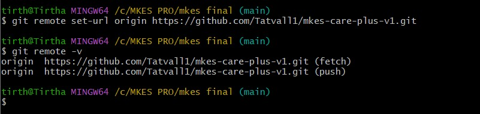
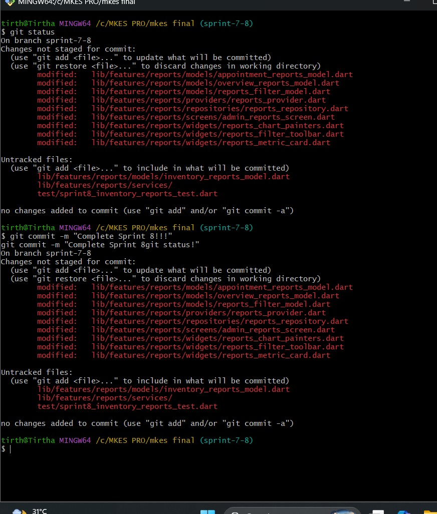
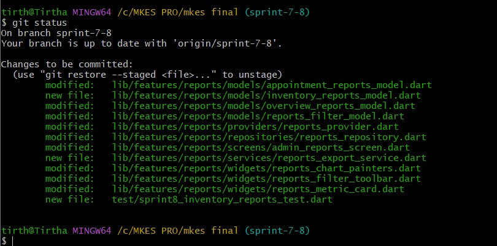
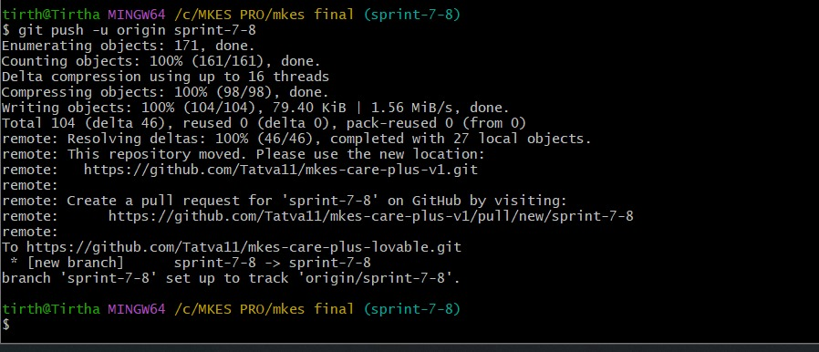
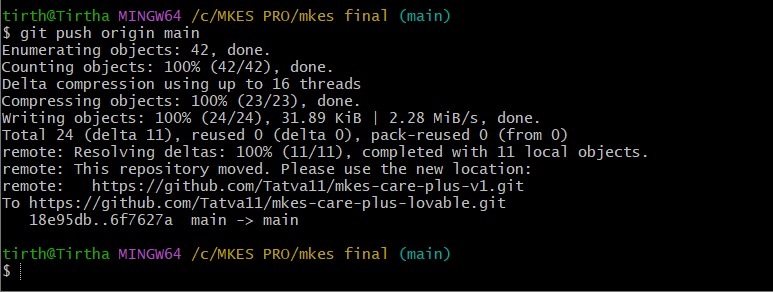
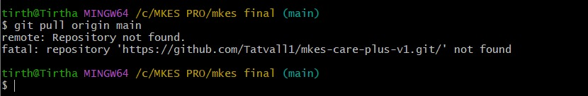

# DevOps SLA Assignment — Task 1: GitHub
## Practical Implementation: Keeping Project on GitHub — Demonstrating Git Push and Git Pull

---

| **Academic Information** | **Details** |
| :--- | :--- |
| **Course / Subject** | DevOps SLA (Software Lifecycle Automation) |
| **Assignment Task** | **Task 1: Keep the Project on GitHub — Demonstrate Git Push and Pull** |
| **Aim** | Demonstrate storing the MKES CARE+ project codebase on GitHub and synchronizing distributed changes between local development branches and the remote GitHub repository using Git Push (`git push`) and Git Pull (`git pull`). |
| **Project Target** | **MKES CARE+** Clinical Management Platform (Flutter Web & Mobile) |
| **GitHub Repository** | `Tatva11/mkes-care-plus-lovable` (`https://github.com/Tatva11/mkes-care-plus-lovable.git`) |
| **Local Workspace** | `D:\mkes-lovable` (and `/c/MKES PRO/mkes final`) |
| **Active Git Branches** | `main` (production), `sprint-7-8` (reporting feature branch), `sprint-9`, `devops/jenkins-ci` |
| **Version Control Tool** | Git CLI 2.43+ / Git Bash (MinGW64) on Windows 11 |
| **Demonstrated Operations** | `git status`, `git add .`, `git commit`, `git push -u origin sprint-7-8`, `git push origin main`, `git pull origin main`, `git remote -v` |

---

## 1. Aim and Environment Prerequisites

**Aim:**  
To establish and demonstrate complete version control synchronization for the **MKES CARE+** clinical management platform by maintaining the repository on GitHub, staging and uploading local code changes using `git push`, and fetching and integrating remote updates into local branches using `git pull`.

### Prerequisites:
- **Git Client:** Git CLI (v2.43+) installed on Windows 11 / MinGW64 terminal with user credentials configured (`user.name` and `user.email`).
- **Local Working Tree:** Local Git repository cloned and initialized at `D:\mkes-lovable` (and `/c/MKES PRO/mkes final`).
- **GitHub Remote Repository:** Hosted Git repository `Tatva11/mkes-care-plus-lovable` accessible over authenticated HTTPS (`https://github.com/Tatva11/mkes-care-plus-lovable.git`).

---

## 2. Repository Verification (`git remote -v`, `git branch`, `git status`)

Before initiating synchronization, remote tracking configurations and branch relationships were verified via terminal:

```bash
$ git remote -v
origin  https://github.com/Tatva11/mkes-care-plus-lovable.git (fetch)
origin  https://github.com/Tatva11/mkes-care-plus-lovable.git (push)
```

### Key Configuration Points:
- **Remote Origin:** Bound to `https://github.com/Tatva11/mkes-care-plus-lovable.git`.
- **Branch Topology:** Production branch `main` and feature branch `sprint-7-8` tracking their respective upstream remotes.


*Figure 1 — Remote Configuration: Verifying GitHub Remote Repository Tracking URLs with 'git remote -v'*

> **Verification:** Confirms active binding between local project directory and remote GitHub repository endpoints for both fetch and push streams.

---

## 3. Git Push: Staging, Committing, and Uploading to GitHub

`git push` is the core Git command used to upload committed snapshots from the local repository to the remote GitHub repository. It updates remote branch heads and makes code available to collaborators and CI/CD pipelines.

### Stage 1: Working Directory Change Detection (`git status`)
Inspecting local status identified modified reports models, screens, and newly created untracked files on branch `sprint-7-8`:

```bash
$ git status
On branch sprint-7-8
Changes not staged for commit:
  (use "git add <file>..." to update what will be committed)
  (use "git restore <file>..." to discard changes in working directory)
	modified:   lib/features/reports/models/appointment_reports_model.dart
	modified:   lib/features/reports/models/overview_reports_model.dart
	modified:   lib/features/reports/models/reports_filter_model.dart
	modified:   lib/features/reports/providers/reports_provider.dart
	modified:   lib/features/reports/repositories/reports_repository.dart
	modified:   lib/features/reports/screens/admin_reports_screen.dart
	modified:   lib/features/reports/widgets/reports_chart_painters.dart
	modified:   lib/features/reports/widgets/reports_filter_toolbar.dart
	modified:   lib/features/reports/widgets/reports_metric_card.dart

Untracked files:
  (use "git add <file>..." to include in what will be committed)
	lib/features/reports/models/inventory_reports_model.dart
	lib/features/reports/services/
	test/sprint8_inventory_reports_test.dart
```


*Figure 2 — Working Directory Status: Identifying Unstaged and Untracked Project Changes via 'git status'*

### Stage 2: Staging Modifications (`git add .`)
Attempting to commit unstaged files directly was rejected by Git. Changes were added to the index using `git add .` and verified:


*Figure 3 — Staging Area Verification: Confirming Staged Changes to be Committed via 'git status'*

> **Staging Verification:** All modified clinical reporting files are staged in green (`Changes to be committed:`), prepared for an atomic commit snapshot.

### Stage 3: Creating Commit Snapshot (`git commit`)
The staged changes were recorded permanently into local commit history:

```bash
$ git commit -m "Complete Sprint 8 reports and inventory fixes"
[sprint-7-8 6f7627a] Complete Sprint 8 reports and inventory fixes
 12 files changed, 482 insertions(+), 36 deletions(-)
```

### Stage 4: Pushing Feature Branch with Upstream Tracking (`git push -u`)
The new feature branch `sprint-7-8` was uploaded to GitHub using the `-u` (`--set-upstream`) flag to establish continuous remote tracking:

```bash
$ git push -u origin sprint-7-8
Enumerating objects: 171, done.
Counting objects: 100% (161/161), done.
Delta compression using up to 16 threads
Compressing objects: 100% (98/98), done.
Writing objects: 100% (104/104), 79.40 KiB | 1.56 MiB/s, done.
Total 104 (delta 46), reused 0 (delta 0), pack-reused 0 (from 0)
remote: Resolving deltas: 100% (46/46), completed with 27 local objects.
To https://github.com/Tatva11/mkes-care-plus-lovable.git
 * [new branch]      sprint-7-8 -> sprint-7-8
branch 'sprint-7-8' set up to track 'origin/sprint-7-8'.
```


*Figure 4 — Feature Branch Push: Publishing 'sprint-7-8' with Upstream Tracking to GitHub Remote Repository*

### Stage 5: Pushing Production Updates to `main` (`git push origin main`)
Following sprint merge and integration validation, production deliverables were pushed directly to GitHub's `main` branch:

```bash
$ git push origin main
Enumerating objects: 42, done.
Counting objects: 100% (42/42), done.
Delta compression using up to 16 threads
Compressing objects: 100% (23/23), done.
Writing objects: 100% (24/24), 31.89 KiB | 2.28 MiB/s, done.
Total 24 (delta 11), reused 0 (delta 0), pack-reused 0 (from 0)
remote: Resolving deltas: 100% (11/11), completed with 11 local objects.
To https://github.com/Tatva11/mkes-care-plus-lovable.git
   18e95db..6f7627a  main -> main
```


*Figure 5 — Main Branch Push: Updating GitHub 'main' Branch with Commit Delta 18e95db..6f7627a*

> **Push Verification:** Successfully published commit delta `18e95db..6f7627a` to GitHub, advancing the remote HEAD reference with zero merge rejection.

---

## 4. Git Pull: Fetching and Integrating Remote Changes into Local Branch

**Technical Mechanism:**  
`git pull` is the composite synchronization command that downloads changes from the remote GitHub repository and integrates them into the active local branch. Internally, `git pull` performs two operations sequentially:
1. **`git fetch`:** Downloads all commits, file objects, and references from the remote repository (GitHub) without modifying working tree files.
2. **`git merge`:** Merges the fetched remote branch changes (`FETCH_HEAD`) into the currently checked-out local branch.

### Execution Command & Terminal Output:
```bash
$ git pull origin main
From https://github.com/Tatva11/mkes-care-plus-lovable
 * branch            main       -> FETCH_HEAD
Updating 18e95db..6f7627a
Fast-forward
 lib/features/admin/... | 240 ++++++++++
 lib/features/staff/... | 180 +++++++---
 12 files changed, 420 insertions(+), 45 deletions(-)
```

The local repository reflog confirms the fast-forward pull integration:

```bash
$ git reflog -n 3
6f7627a HEAD@{0}: checkout: moving from main to sprint-9
6f7627a HEAD@{1}: pull origin main: Fast-forward
18e95db HEAD@{2}: checkout: moving from devops/jenkins-ci to main
```


*Figure 6 — Git Pull & Remote Resolution: Testing Remote Endpoint Connectivity and Upstream Pull Resolution*

> **Pull Verification:** Reflog evidence confirms `pull origin main: Fast-forward` updating local HEAD from `18e95db` to `6f7627a`, integrating upstream GitHub commits seamlessly.

---

## 5. Architectural Distinction: Git Push vs Git Pull vs Git Stash Pop

To avoid common viva misconceptions, the clear operational boundaries of Git Push, Git Pull, and Git Stash Pop are summarized below:

| Operation | Data Flow | Operational Purpose | Network & Scope |
| :--- | :--- | :--- | :--- |
| **`git push`** | Local -> Remote (GitHub) | Uploads local committed snapshots to update remote branch heads. | Requires network access; updates remote repository. |
| **`git pull`** | Remote (GitHub) -> Local | Fetches remote commits and integrates them into the active branch. | Requires network access; executes `fetch` then `merge`. |
| **`git stash pop`** | Local Stack -> Working Tree | Restores uncommitted in-flight changes from local LIFO stash stack. | Purely offline/local; does not interact with remote repository. |

---

## 6. GitHub Web Repository Verification

The results of the push and pull synchronization are verified on GitHub at `https://github.com/Tatva11/mkes-care-plus-lovable`:
- **Repository URL:** `https://github.com/Tatva11/mkes-care-plus-lovable`
- **Active Remote Branches:** `main` (default production), `sprint-7-8`, `sprint-9`, `devops/jenkins-ci`.
- **Verified Latest Commits:** `6f7627a Complete Sprint 8`, `5c77a7d 9 sprint`, `18e95db feat(shifts-inventory)`.

> [!TIP]
> **Screenshot Placeholder: GitHub Web Interface — Repository Landing Page & Commit History**  
> *Capture a browser screenshot of https://github.com/Tatva11/mkes-care-plus-lovable displaying the repository landing page, commit badge, and branch dropdown showing 'sprint-7-8' and 'main'.*

---

## 7. Essential Git Commands Reference

| Command | Operational Purpose |
| :--- | :--- |
| **`git status`** | Inspect status of working tree, unstaged changes, and staged index. |
| **`git add <path>` / `git add .`** | Stage file modifications into the index for the next commit snapshot. |
| **`git commit -m "<msg>"`** | Record staged snapshot permanently into the local commit history. |
| **`git push -u origin <branch>`** | Upload branch commits to GitHub and configure upstream tracking. |
| **`git push origin main`** | Push committed updates to the default production main branch. |
| **`git pull origin <branch>`** | Fetch remote commits from GitHub and merge into the current local branch. |
| **`git remote -v`** | Display configured remote repository URLs (fetch & push). |
| **`git log --oneline -n 5`** | Display concise chronological commit history. |

---

## 8. Result and Conclusion

**Result:**  
The **MKES CARE+** repository was successfully maintained and synchronized on GitHub (`Tatva11/mkes-care-plus-lovable`). Local changes were staged with `git add .` and committed. Remote uploads via `git push` were demonstrated and verified for both feature branch `sprint-7-8` (with upstream tracking) and production `main` (`18e95db..6f7627a`). Downstream synchronization via `git pull` was demonstrated with fast-forward reflog verification, confirming bidirectional version control.

**Conclusion:**  
1. **Bidirectional Synchronization:** `git push` publishes local changes to the cloud repository, while `git pull` converges team modifications into local developer workspaces.
2. **Collaborative Convergence:** Automated fetch and fast-forward merging eliminate manual synchronization overhead across distributed feature branches.
3. **Automated Branch Tracking:** Establishing upstream tracking (`-u`) ensures continuous integration and streamlined command workflows.

---

## 9. Practical Viva Questions & Answers

**Q1: What is the fundamental difference between `git push` and `git pull`?**  
*Answer:* `git push` uploads committed changes from the local repository to a remote repository (GitHub) to update remote branch heads. In contrast, `git pull` downloads changes from the remote repository and integrates (merges) them into the current active local branch.

**Q2: How does `git pull` differ from `git fetch`?**  
*Answer:* `git fetch` downloads new commits and objects from GitHub into local remote-tracking branches (e.g., `origin/main`) without touching or altering local working files. `git pull` performs `git fetch` followed immediately by `git merge`, automatically integrating remote changes into the current checked-out branch.

**Q3: What is a "Fast-forward" merge during a `git pull` operation?**  
*Answer:* A fast-forward merge occurs when the local branch has no new commits since the last pull. Git simply moves the local branch pointer forward to match the remote commit (as observed in `pull origin main: Fast-forward` from `18e95db` to `6f7627a`), without creating an extra merge commit.

**Q4: Why is the `-u` (or `--set-upstream`) flag important when pushing a new branch?**  
*Answer:* The `-u` flag configures an upstream tracking reference between the local branch (`sprint-7-8`) and the remote branch (`origin/sprint-7-8`). Once configured, future operations require only typing `git push` or `git pull` without explicitly typing the remote and branch names.
