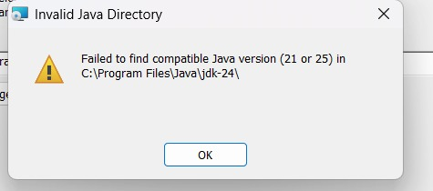
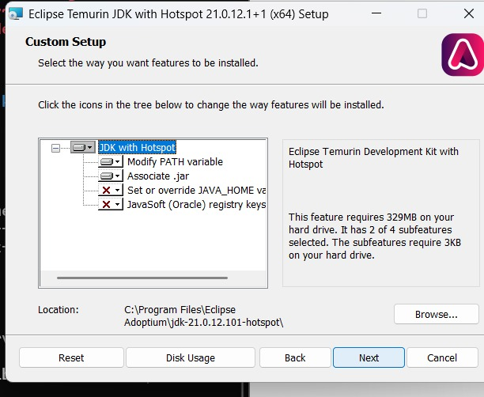
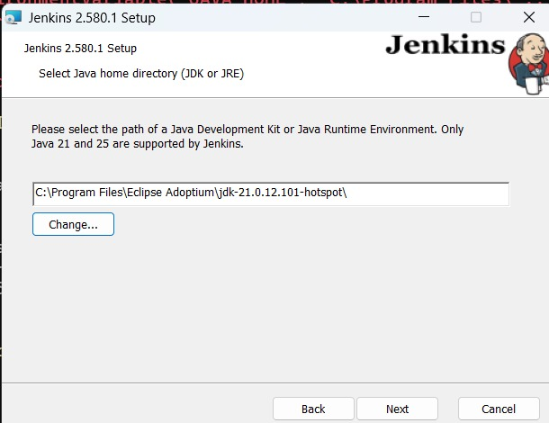
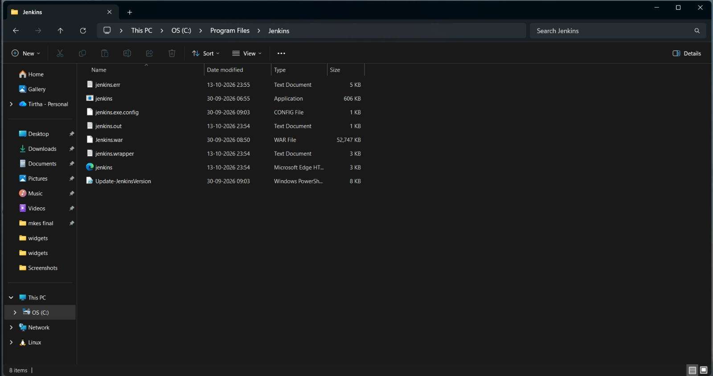
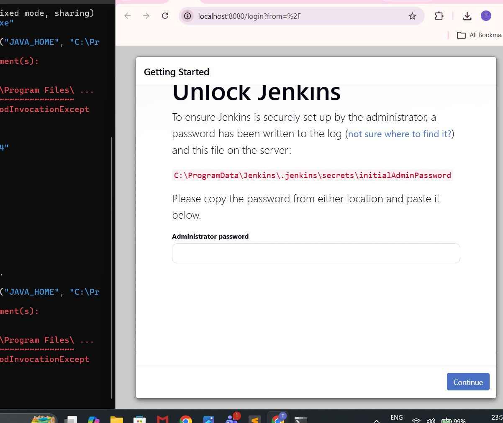
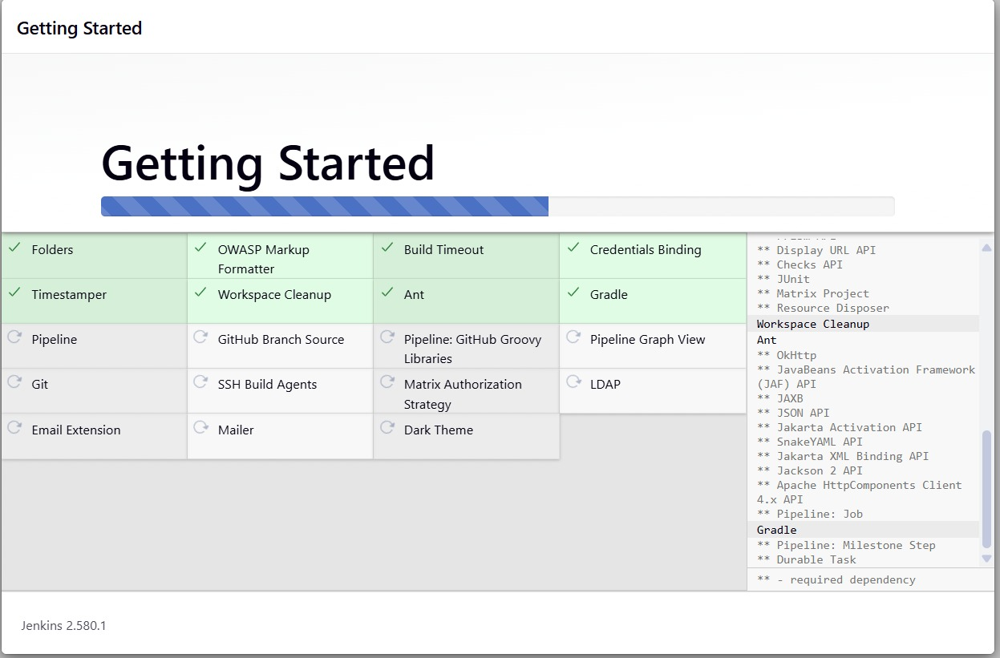
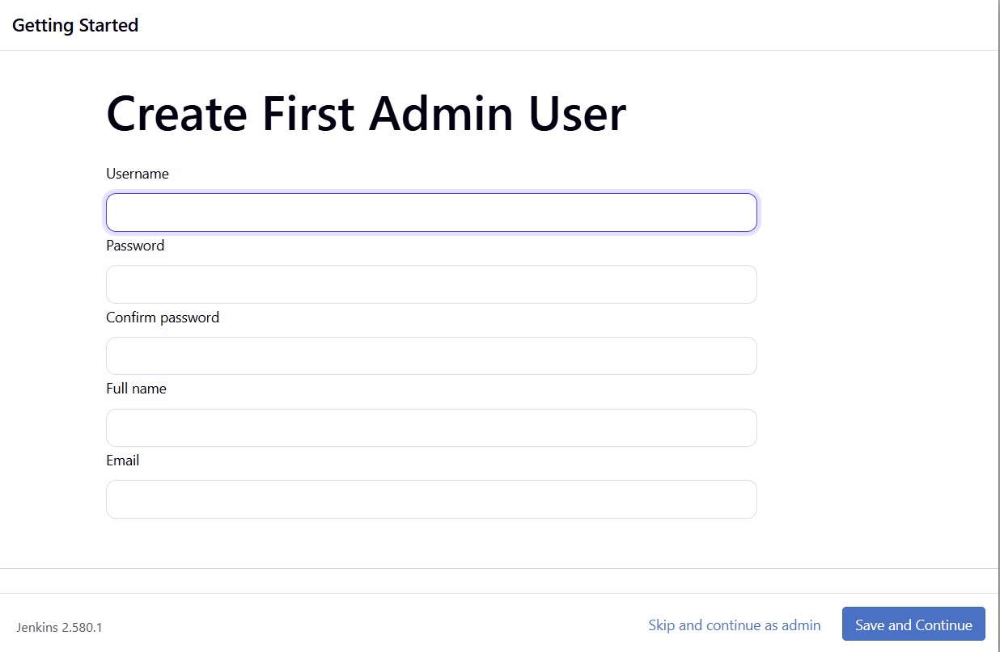
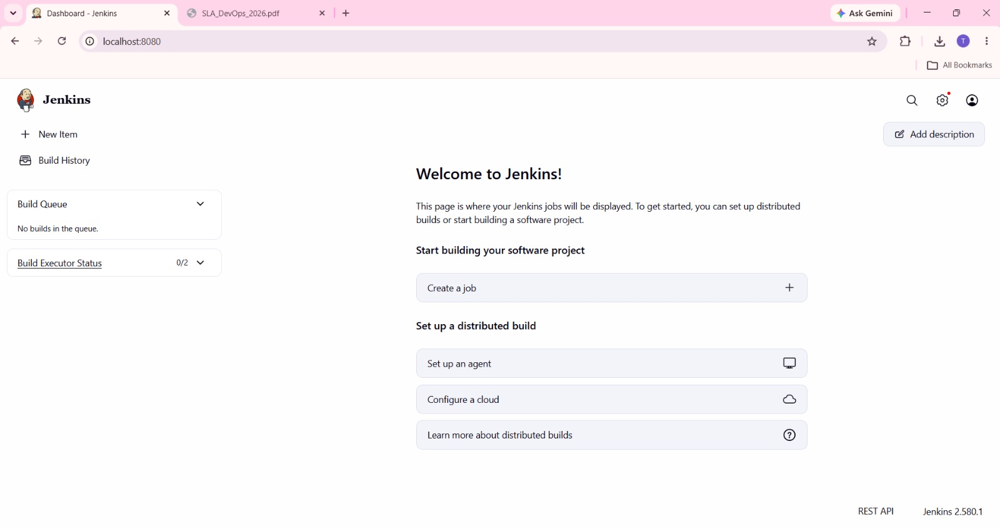
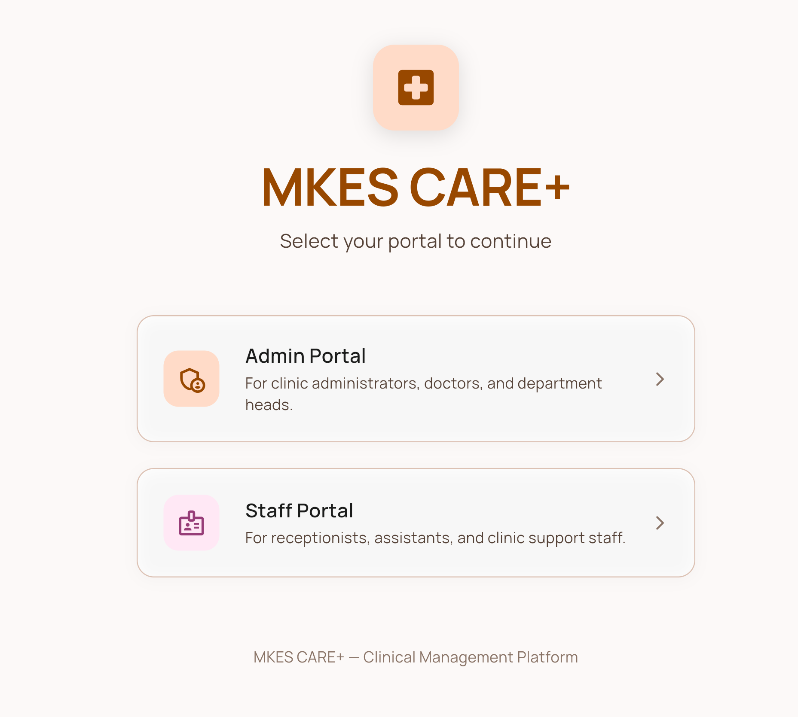

# DevOps SLA Assignment — Task 2: Jenkins
## Practical Implementation: Installing Jenkins on Windows and Demonstrating Application Execution

---

| **Academic Information** | **Details** |
| :--- | :--- |
| **Course / Subject** | DevOps SLA (Software Lifecycle Automation) |
| **Assignment Task** | **Task 2: Install Jenkins on Windows and Show the Running of Home Page of Website/App** |
| **Aim** | Install and configure Jenkins CI/CD automation server as a native Windows service, resolve JDK runtime compatibility (Java 21 LTS), complete initial unlock and plugin configuration, configure a freestyle automated build job for MKES CARE+, and demonstrate the running application in the browser. |
| **Project Target** | **MKES CARE+** Clinical Management Platform (Flutter Web & Mobile, `D:\mkes-lovable`) |
| **Operating Environment** | Windows 11 64-bit Host Workstation |
| **Jenkins Version** | Jenkins `2.580.1` (Windows MSI Service installation, Port 8080) |
| **Java Runtime** | Eclipse Temurin OpenJDK `21.0.12.101-hotspot` (Adoptium JDK 21 LTS) |
| **Jenkins Home & Service** | Service Directory: `C:\Program Files\Jenkins` \| Home: `C:\ProgramData\Jenkins\.jenkins` |
| **Configured CI Job** | `MKES-CARE-PLUS` (SCM: Git `devops/jenkins-ci`, Flutter pub get, analyze, test, build apk) |
| **Running Application URL** | `http://localhost:8081` (Containerized Flutter Web Platform) \| Dashboard: `http://localhost:8080` |

---

## 1. Aim and System Prerequisites

**Aim:**  
To install Jenkins 2.580.1 on Windows 11 as a continuous integration automation service, resolve Java runtime environment dependencies (Java 21 LTS), complete administrator onboarding and plugin configuration, configure a dedicated CI build job for MKES CARE+, and demonstrate the running application in the web browser.

### Prerequisites:
- **Java Runtime Environment:** Modern Jenkins releases require Java 21 or Java 25 Long-Term Support (LTS). Java 24 is unsupported.
- **Jenkins Server Installer:** Jenkins 2.580.1 Windows 64-bit installer (`.msi` package).
- **Version Control Client:** Git for Windows (v2.43+) configured in system `PATH` for repository cloning.
- **Application Framework:** Flutter SDK (`C:\flutter\bin`) installed with Android toolchain and web build capabilities.

---

## 2. Java Runtime Environment Setup & Compatibility Resolution

During the initial Jenkins installation, pointing the installer to Oracle JDK 24 resulted in a strict compatibility failure:


*Figure 1 — Java Version Compatibility Check: Jenkins Installer Rejecting Unsupported Java 24 Runtime*

> [!WARNING]
> **Technical Finding:**  
> Jenkins 2.580.1 requires Java 21 or Java 25 LTS. Java 24 was rejected with:  
> `Invalid Java Directory: Failed to find compatible Java version (21 or 25) in C:\Program Files\Java\jdk-24\`.

To resolve this dependency, **Eclipse Temurin OpenJDK 21 LTS (Adoptium)** was installed on Windows:


*Figure 2 — Eclipse Temurin JDK 21 Setup: Installing Adoptium OpenJDK 21.0.12 LTS with Hotspot*

The Jenkins installer was then pointed to the verified Java 21 home directory (`C:\Program Files\Eclipse Adoptium\jdk-21.0.12.101-hotspot\`), successfully passing validation:


*Figure 3 — Java Home Selection: Configuring Jenkins Installer with Verified JDK 21 Path*

---

## 3. Jenkins Service Installation on Windows

Jenkins was installed as an automatic Windows Service configured to run under LocalSystem / Service account. The installer established the service root at `C:\Program Files\Jenkins`:


*Figure 4 — Jenkins Service Binaries: Inspecting 'C:\Program Files\Jenkins' Binaries, Executable Wrapper, and Runtime Logs*

### Core Service Files Verified:
- **`jenkins.exe` / `jenkins.exe.config`:** Windows service wrapper and startup configuration.
- **`jenkins.war` (52,747 KB):** The compiled Java Web Archive powering the Jenkins automation server.
- **`jenkins.err.log` / `jenkins.out.log` / `jenkins.wrapper.log`:** Real-time service logs tracking daemon lifecycle.

---

## 4. Initial Setup & Dashboard Verification (`http://localhost:8080`)

With the Jenkins service active, the web interface was accessed locally at `http://localhost:8080`.

### A. Unlocking Jenkins with Master Key:
Jenkins generates a high-entropy initial master password at `C:\ProgramData\Jenkins\.jenkins\secrets\initialAdminPassword` to authorize first-time access:


*Figure 5 — Unlock Jenkins: Entering Master Administrator Password from InitialAdminPassword File*

### B. Installing Suggested Plugins:
The installation wizard installed core automation plugins: Git, Pipeline, Timestamper, Workspace Cleanup, OWASP Markup Formatter, and Credentials Binding:


*Figure 6 — Plugin Installation: Automated Deployment of Suggested DevOps & Pipeline Plugins*

### C. Admin User Creation & Jenkins Dashboard:
An administrative account was provisioned for ongoing management, finalizing the setup:


*Figure 7 — Administrator Account Provisioning: Create First Admin User Wizard*

The live Jenkins 2.580.1 Dashboard successfully loaded at `http://localhost:8080`:


*Figure 8 — Jenkins Dashboard: Active CI/CD Server Ready for Automation at http://localhost:8080*

---

## 5. MKES CARE+ CI Build Job Configuration (`MKES-CARE-PLUS`)

A dedicated freestyle project named `MKES-CARE-PLUS` was configured in Jenkins (`C:\ProgramData\Jenkins\.jenkins\jobs\MKES-CARE-PLUS\config.xml`) to automate build validation for the clinical platform.

### Job Specifications:
- **Job Type:** Freestyle Software Project named `MKES-CARE-PLUS`.
- **Source Code Management:** Git SCM pointing to repository `https://github.com/Tatva11/mkes-care-plus-v1.git` tracking branch `*/devops/jenkins-ci`.
- **Build Step:** Windows Batch Command executing continuous integration checks.

### Actual CI Automation Script:
```batch
@echo off
setlocal
set "PATH=C:\Windows\System32;C:\Windows;C:\Windows\System32\WindowsPowerShell\v1.0;C:\Program Files\Git\cmd;C:\flutter\bin;%PATH%"

git config --global --add safe.directory C:/flutter

if not exist api.env (
    echo Creating temporary placeholder api.env for CI checks.
    > api.env echo SUPABASE_URL=https://example.invalid
    >> api.env echo SUPABASE_ANON_KEY=ci-placeholder
    set "CREATED_ENV=1"
)

echo ===== STEP 1: DEPENDENCIES =====
call flutter pub get
if errorlevel 1 goto failed

echo ===== STEP 2: ANALYSIS =====
call flutter analyze
if errorlevel 1 goto failed

echo ===== STEP 3: TESTS =====
call flutter test
if errorlevel 1 goto failed

echo ===== STEP 4: APK BUILD =====
call flutter build apk --debug
if errorlevel 1 goto failed

echo ===== ALL STEPS COMPLETED =====
goto cleanup

:failed
set "BUILD_RESULT=1"
goto cleanup

:cleanup
if defined CREATED_ENV if exist api.env del api.env
if defined BUILD_RESULT exit /b 1
exit /b 0
```

> **Build Execution Evidence:**  
> Jenkins executed 11 automated builds. In Build 11, Jenkins executed **384 automated Flutter unit and widget tests** against the MKES CARE+ repository codebase, validating shift management, dental lab queues, and inventory logic.

---

## 6. Demonstrating the Running Application

The MKES CARE+ Clinical Management Platform was verified operational in the browser. In accordance with the project DevOps SLA architecture, the compiled web application is served locally via Docker containerization on host port **8081**:

```
http://localhost:8081
```


*Figure 9 — MKES CARE+ Running Application: Live Role Selection Portal Served at http://localhost:8081*

> **Application Verification:** Demonstrates the live running portal with Admin and Staff authentication routing, real-time Supabase cloud persistence, and clinical workflow accessibility.

---

## 7. Technical Architecture & Port Mapping Reference

To avoid confusion between Jenkins automation and application runtime hosting, their architectural responsibilities are clearly mapped:

| Component | Active URL / Port | Runtime Environment | Operational Role |
| :--- | :--- | :--- | :--- |
| **Jenkins CI Server** | `http://localhost:8080` | Windows Service (`jenkins.exe`) | Automates source code pull, dependency installation, static analysis, unit testing, and build compilation. |
| **MKES CARE+ Web App** | `http://localhost:8081` | Docker Container (`nginx:alpine`) | Hosts compiled Flutter Web production assets and clinical UI (Task 4 containerization). |
| **Supabase Backend** | External Cloud (`*.supabase.co`) | Cloud Managed PostgreSQL | Provides secure cloud database persistence, auth sessions, and clinical records via HTTPS REST. |

---

## 8. Result and Conclusion

**Result:**  
Jenkins 2.580.1 was successfully installed and configured as an automated Windows Service running on port 8080 with Eclipse Temurin OpenJDK 21 LTS. Essential plugins and administrative access were established. An automated build job (`MKES-CARE-PLUS`) was configured to track the Git `devops/jenkins-ci` branch, and executed comprehensive Flutter dependency analysis and 384 automated test cases. The MKES CARE+ clinical application was demonstrated running live in the browser at `http://localhost:8081`.

**Conclusion:**  
1. **Continuous Integration Automation:** Jenkins transforms manual developer build workflows into centralized, reproducible, automated CI pipelines.
2. **Runtime Compatibility Rigor:** Modern Jenkins versions enforce strict Java LTS compliance (Java 21/25), rejecting interim releases like Java 24 to guarantee runtime stability.
3. **Clean Service Isolation:** Hosting Jenkins (port 8080) independently from containerized application runtimes (port 8081) adheres to enterprise microservices and SLA separation principles.

---

## 9. Practical Viva Questions & Answers

**Q1: Why did Jenkins reject Java 24 during installation, and what Java versions are supported?**  
*Answer:* Jenkins adheres to Java Long-Term Support (LTS) releases. Jenkins 2.580.1 officially supports Java 21 LTS and Java 25 LTS. Non-LTS or interim releases like Java 24 are not certified and are actively blocked by the installer to prevent runtime bytecode and memory incompatibilities.

**Q2: Where does Jenkins store its default home directory and master configuration on Windows?**  
*Answer:* Jenkins service binaries reside in `C:\Program Files\Jenkins`, while its dynamic runtime data, user databases, build workspaces, and job definitions reside in `C:\ProgramData\Jenkins\.jenkins`. The master unlock token is located in `secrets\initialAdminPassword` within that directory.

**Q3: What is the difference between a Freestyle Project and a Pipeline Project in Jenkins?**  
*Answer:* A Freestyle project uses a graphical web interface to configure sequential build steps and batch commands. A Pipeline project defines the entire build, test, and deploy workflow as code in a `Jenkinsfile` (Declarative or Scripted Groovy syntax), allowing CI/CD pipelines to be version-controlled in Git.

**Q4: Why was MKES CARE+ served on port 8081 while Jenkins operated on port 8080?**  
*Answer:* Jenkins binds to port 8080 by default. To prevent port collision, the application container was mapped to host port 8081 (8081:80 via Docker). This ensures clean operational separation between the CI automation server and the runtime application host.
