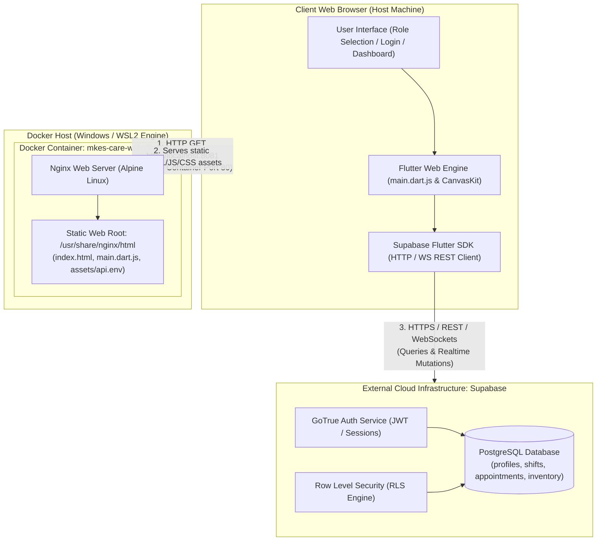
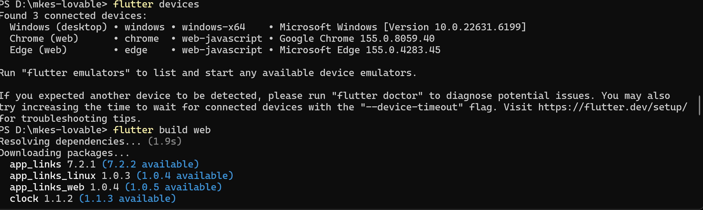
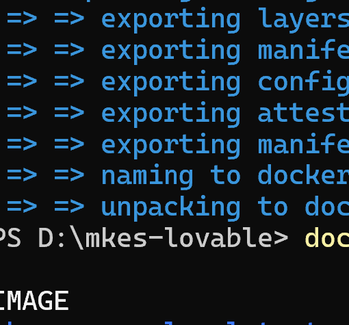
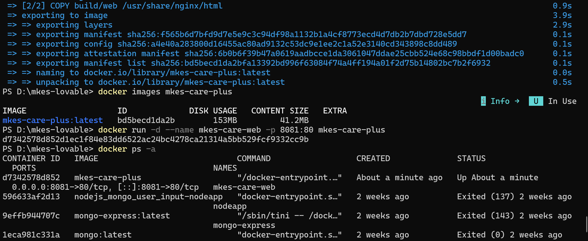
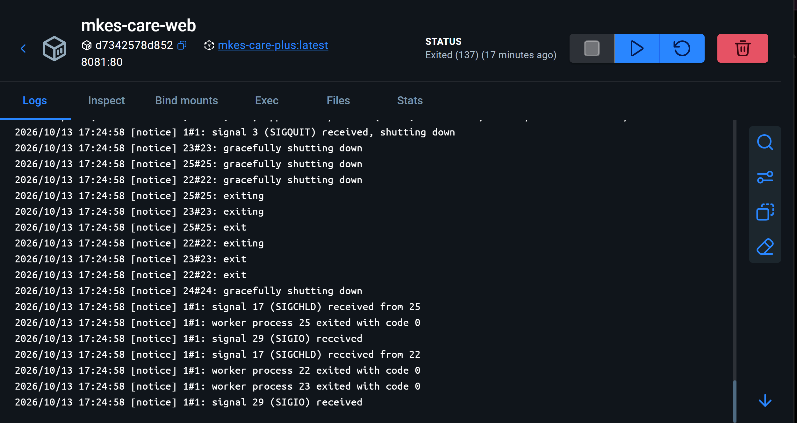
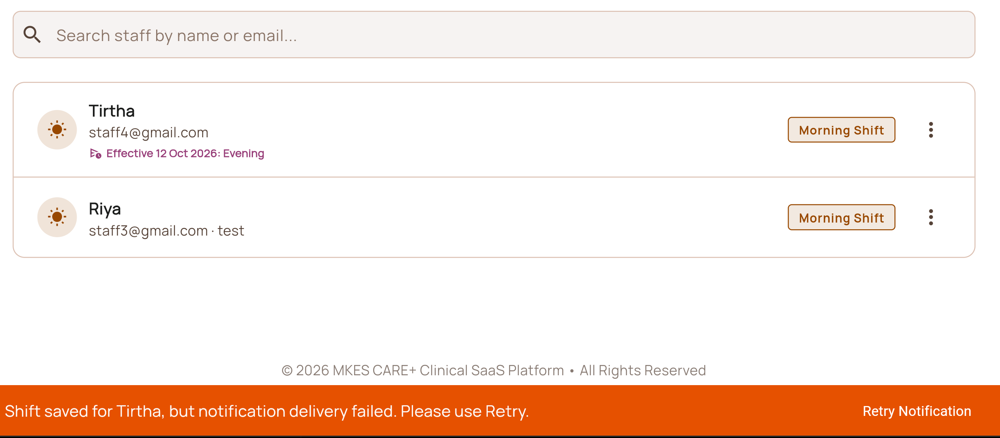

# DevOps SLA Practical File  -  Task 4: Docker
## Containerization of MKES CARE+ Clinical Management Platform (Flutter Web)

---

| **Academic Information** | **Details** |
| :--- | :--- |
| **Course / Subject** | DevOps SLA (Software Lifecycle Automation) |
| **Assignment Task** | **Task 4: Docker** |
| **Task Statement** | *"Create a Docker image of the login/registration page and demonstrate working using database connectivity."* |
| **Project Name** | **MKES CARE+** (Clinical Management SaaS Platform) |
| **Project Repository** | `D:\mkes-lovable` |
| **Target Technology Stack** | Flutter Web 3.x, Nginx Alpine, Docker Engine / Desktop, Supabase (PostgreSQL BaaS) |
| **Application Host Port** | `http://localhost:8081` |
| **Container Name** | `mkes-care-web` |
| **Docker Image Name** | `mkes-care-plus:latest` |

---

## Table of Contents
1. [Aim](#1-aim)
2. [Introduction to Docker](#2-introduction-to-docker)
   - 2.1 Virtualization vs Containerization
   - 2.2 Docker Core Architecture (Client, Host, Daemon, Registry)
   - 2.3 Why Docker in DevOps and SLA Pipelines
3. [Project Overview  -  MKES CARE+](#3-project-overview--mkes-care)
   - 3.1 Architectural Decomposition
   - 3.2 Frontend vs Backend Boundary
   - 3.3 System Architecture Diagram
4. [Prerequisites](#4-prerequisites)
   - 4.1 System & Environment Requirements
   - 4.2 Verification of Connected Toolchains
5. [Flutter Web Build Process](#5-flutter-web-build-process)
   - 5.1 Compilation from Dart to Web Assets
   - 5.2 Build Command Execution
   - 5.3 Inspection of the Build Artifacts (`build/web`)
6. [Dockerfile Creation and Explanation](#6-dockerfile-creation-and-explanation)
   - 6.1 Dockerfile Source Code
   - 6.2 Line-by-Line Instruction Breakdown
   - 6.3 Rationale for `nginx:alpine`
7. [Building the Docker Image](#7-building-the-docker-image)
   - 7.1 Build Command and Build Context
   - 7.2 Build Execution Trace
   - 7.3 Local Image Verification (`docker images`)
8. [Running the Docker Container](#8-running-the-docker-container)
   - 8.1 Execution Command Breakdown (`docker run`)
   - 8.2 Port Forwarding and Host Mapping Rationale (`8081:80`)
9. [Verifying the Running Container](#9-verifying-the-running-container)
   - 9.1 Verification via Docker CLI (`docker ps -a`)
   - 9.2 Verification via Docker Desktop GUI
   - 9.3 Container Lifecycle and Server Log Inspection (`docker logs`)
10. [Accessing the Application through the Browser](#10-accessing-the-application-through-the-browser)
    - 10.1 Web Navigation (`http://localhost:8081`)
    - 10.2 Authentication & Portal Routing (`RoleSelectionScreen`)
11. [Supabase Database / Backend Connectivity](#11-supabase-database--backend-connectivity)
    - 11.1 Client-Side BaaS Architecture
    - 11.2 Environment File Bundling (`api.env`) & Critical Security Analysis
    - 11.3 Demonstration of Live Backend Operations
    - 11.4 Missing Evidence & Recommended Test Procedure
12. [Important Docker Commands](#12-important-docker-commands)
13. [Result](#13-result)
14. [Conclusion](#14-conclusion)
15. [Viva-Voce Questions and Answers](#15-viva-voce-questions-and-answers)

---

## 1. Aim

To containerize the **MKES CARE+** Flutter web application by constructing an optimized Docker image based on `nginx:alpine`, deploying the image as a standalone container mapped to host port `8081`, verifying container lifecycle and runtime logs, accessing the application portal in a web browser, and critically examining external database connectivity with the **Supabase** backend.

---

## 2. Introduction to Docker

### 2.1 Virtualization vs Containerization
Traditional deployment environments relied on **Hypervisor-based Virtual Machines (VMs)**. Each VM virtualizes the underlying physical hardware and runs a complete, redundant guest operating system (Kernel, device drivers, OS libraries), leading to heavy disk usage (gigabytes), substantial memory consumption, and slow startup times (minutes).

**Docker** provides **OS-level virtualization (Containerization)**. Containers share the host operating system’s kernel and leverage Linux kernel isolation primitives:
- **Namespaces** (PID, NET, IPC, MNT, UTS) to ensure process, networking, and filesystem isolation.
- **Control Groups (cgroups)** to govern and throttle resource usage (CPU, RAM, I/O).

| Feature | Virtual Machines (VMs) | Docker Containers |
| :--- | :--- | :--- |
| **Architecture** | Hypervisor + Guest OS per VM | Shared Host Kernel + Isolated User-space |
| **Footprint** | Heavy (~5 GB – 30 GB) | Extremely Lightweight (~5 MB – 200 MB) |
| **Boot Time** | Minutes | Milliseconds to Seconds |
| **Resource Efficiency** | Low (Duplicated OS overhead) | High (Near bare-metal performance) |
| **Portability** | Hypervisor-dependent disk images | Standard Open Container Initiative (OCI) images |

### 2.2 Docker Core Architecture
Docker operates as a client-server architecture consisting of three primary components:
1. **Docker Client (`docker` CLI / Docker Desktop):** The user interface through which commands such as `build`, `run`, and `ps` are issued.
2. **Docker Host (Docker Daemon - `dockerd`):** The long-running background service managing container images, running containers, virtual networks, and storage volumes.
3. **Docker Registry (e.g., Docker Hub):** A centralized or private repository that hosts versioned Docker images.

### 2.3 Why Docker in DevOps and SLA Pipelines
In a Software Lifecycle Automation (SLA) framework, Docker solves the notorious **"Works on my machine"** problem. By bundling the application code, its runtime dependencies, configuration, and web server into an immutable container image:
- Developers test the identical artifact that deploys to staging and production.
- CI/CD pipelines automate linting, compilation, containerization, and automated integration testing deterministically.
- Rollbacks and canary deployments require merely changing container tags.

---

## 3. Project Overview  -  MKES CARE+

### 3.1 Architectural Decomposition
**MKES CARE+** is a clinical management platform engineered using Flutter (`>=3.3.0 <4.0.0`). The system features modular clinical subsystems:
- **Authentication & Role Selection:** Portal differentiation between Clinic Administrators, Department Heads, Doctors, and Clinical Staff.
- **Clinical Modules:** Eye surgery tracking, dental lab workflows, historical patient records, appointment scheduling.
- **Inventory Management:** Central stock transfers, batch expiry tracking, and purchase order fulfillment.

### 3.2 Frontend vs Backend Boundary
A critical architectural concept often probed in practical vivas is understanding where container boundaries begin and end:
- **The Container is a Frontend Web Server:** The Docker container built in this task contains **only** the static, compiled Flutter web client (`HTML`, `JS`, `CanvasKit/WASM`, assets) served by Nginx.
- **The Backend is External (Supabase BaaS):** The PostgreSQL database, authentication microservices, Row Level Security (RLS) policies, and edge functions reside on the external Supabase cloud infrastructure (`*.supabase.co`).
- **No Database Inside the Container:** Docker does **not** package PostgreSQL inside this container. All database connectivity occurs over outbound client-side HTTPS/WebSocket network calls initiated by the client browser directly to Supabase.

### 3.3 System Architecture Diagram



---

## 4. Prerequisites

Before containerizing MKES CARE+, ensure the following toolchains and runtime services are installed and active:

1. **Flutter SDK:** Version `3.3.0` or higher configured with Web support enabled (`flutter config --enable-web`).
2. **Google Chrome / Edge:** Web browser engine required by Flutter web build tools and for manual functional verification.
3. **Docker Desktop for Windows:** Installed with WSL2 backend or Hyper-V backend, with the Docker engine in **Running** state.
4. **Git & PowerShell:** Command-line environments for executing repository operations and container lifecycle management.
5. **Project Source Code:** Clean clone of `mkes-lovable` located at `D:\mkes-lovable`.
6. **Application Environment Configuration:** `api.env` file in the project root declaring `SUPABASE_URL` and `SUPABASE_ANON_KEY`.

### Verification of Connected Toolchains
Running `flutter devices` verifies that the Flutter toolchain recognizes web compilation targets on the host machine:

```powershell
PS D:\mkes-lovable> flutter devices
```

The toolchain detects the desktop and web targets:
- `Windows (desktop)`  -  Windows x64
- `Chrome (web)`  -  Google Chrome
- `Edge (web)`  -  Microsoft Edge

---

## 5. Flutter Web Build Process

### 5.1 Compilation from Dart to Web Assets
Flutter web operates by compiling Dart source code into standard web artifacts:
- **Dart to JavaScript:** `lib/main.dart` and its dependencies are compiled into `main.dart.js` (an optimized JavaScript bundle).
- **CanvasKit / HTML Renderer:** WebAssembly (WASM) and CanvasKit binaries are bundled into `build/web/canvaskit` to deliver high-performance graphics rendering identical to mobile.
- **Static Assets & Environment Bundling:** Asset declarations from `pubspec.yaml` (including fonts, images, and `api.env`) are placed under `build/web/assets/`.

### 5.2 Build Command Execution
Execute the production web build command in PowerShell from the project root:

```powershell
PS D:\mkes-lovable> flutter build web
```

During this step, the Flutter build toolchain:
1. Resolves package dependencies from `pubspec.yaml` and `pubspec.lock`.
2. Compiles application screens (`AuthWrapper`, `RoleSelectionScreen`, `AdminLoginScreen`, etc.) into production JavaScript.
3. Injects service worker caches (`flutter_service_worker.js`) and startup bootstrap files (`flutter_bootstrap.js`).


*Figure 1  -  Compiling MKES CARE+ to Web Assembly and Static JavaScript Assets using `flutter build web`*

> **What Figure 1 Proves:**  
> Figure 1 confirms the execution of `flutter devices` detecting connected web compilers (Chrome and Edge), followed immediately by the invocation of `flutter build web` within `D:\mkes-lovable`. It establishes that the build process resolved all application dependencies without compiler syntax errors.

### 5.3 Inspection of the Build Artifacts (`build/web`)
After the build completes, the static distribution directory `D:\mkes-lovableuild\web` contains:

| File / Folder | Purpose in Deployment |
| :--- | :--- |
| `index.html` | Entry point webpage loading the Flutter engine bootstrap scripts |
| `main.dart.js` | Compiled application code (~4.6 MB) containing all widgets and business logic |
| `flutter_bootstrap.js` | Initializes and configures the Flutter web runtime |
| `flutter.js` | Core loader script that fetches engine scripts and manages service workers |
| `canvaskit/` | Contains `canvaskit.wasm` and `canvaskit.js` for Skia graphics rendering |
| `assets/` | Packaged application assets, including fonts, shaders, and `api.env` |
| `manifest.json` | Web Application Manifest declaring PWA properties and theme colors |

---

## 6. Dockerfile Creation and Explanation

### 6.1 Dockerfile Source Code
In the root directory of the project (`D:\mkes-lovable\Dockerfile`), create the Docker configuration file:

```dockerfile
FROM nginx:alpine
COPY build/web /usr/share/nginx/html
EXPOSE 80
```

### 6.2 Line-by-Line Instruction Breakdown

#### Line 1: `FROM nginx:alpine`
- **Instruction:** `FROM` sets the base container image upon which all subsequent layers are constructed.
- **Image Selected:** `nginx:alpine` provides the official high-performance Nginx HTTP web server running on **Alpine Linux**.
- **DevOps Significance:** Alpine Linux is a security-oriented, ultra-lightweight Linux distribution. While a standard Debian-based Nginx image exceeds 140 MB before adding code, `nginx:alpine` has a compressed base footprint of only ~5 MB to ~23 MB, radically minimizing image transfer overhead, build duration, and container attack surface.

#### Line 2: `COPY build/web /usr/share/nginx/html`
- **Instruction:** `COPY` transfers files and directories from the host build context into the filesystem of the container.
- **Source Path:** `build/web` refers to the directory containing the static output generated by `flutter build web`.
- **Destination Path:** `/usr/share/nginx/html` is the default document root where Nginx searches for `index.html` and static assets.
- **DevOps Significance:** By placing the static files directly into Nginx's document root, Nginx automatically serves the Flutter web app without requiring custom `nginx.conf` modifications for basic static hosting.

#### Line 3: `EXPOSE 80`
- **Instruction:** `EXPOSE` serves as architectural documentation indicating the network port on which the container's internal process listens for connections.
- **Port:** `80` is the standard TCP port for unencrypted HTTP traffic served by Nginx.
- **Important Note:** `EXPOSE` does **not** publish the port to the host system automatically; actual network forwarding requires the `-p` flag during `docker run`.

---

## 7. Building the Docker Image

### 7.1 Build Command and Build Context
Build the container image using the Docker CLI in PowerShell:

```powershell
PS D:\mkes-lovable> docker build -t mkes-care-plus .
```

- `-t mkes-care-plus`: Tags (names) the resulting image as `mkes-care-plus`. By default, the tag `:latest` is appended (`mkes-care-plus:latest`).
- `.`: Specifies the **build context** as the current working directory (`D:\mkes-lovable`). Docker packages the contents of this directory (filtered by `.dockerignore`, if present) and transmits it to the Docker daemon.

### 7.2 Build Execution Trace
During execution, the Docker BuildKit engine performs the following tasks:
1. Loads the base image `nginx:alpine` from cache or pulls it from Docker Hub.
2. Executes Step `[2/2] COPY build/web /usr/share/nginx/html`, writing the static Flutter web payload into the image layer.
3. Exports and commits image layers, generates SHA256 manifests, and tags the final artifact as `docker.io/library/mkes-care-plus:latest`.


*Figure 2a  -  Docker Build Engine Exporting Container Layers and Writing Manifest List*

### 7.3 Local Image Verification (`docker images`)
Verify that the image is present in the local Docker image store:

```powershell
PS D:\mkes-lovable> docker images mkes-care-plus
```

**Observed Terminal Output:**
```
IMAGE                   ID             DISK USAGE   CONTENT SIZE   EXTRA
mkes-care-plus:latest   bd5becd1da2b   153MB        41.2MB
```

- **Image ID:** `bd5becd1da2b`
- **Disk Usage:** `153 MB` (Total uncompressed size on disk, encompassing Alpine OS, Nginx binaries, and Flutter web assets)
- **Content Size:** `41.2 MB` (Compressed layer payload)

---

## 8. Running the Docker Container

### 8.1 Execution Command Breakdown (`docker run`)
Launch the containerized application with the following command:

```powershell
PS D:\mkes-lovable> docker run -d --name mkes-care-web -p 8081:80 mkes-care-plus
```

| Parameter / Flag | Purpose and Behavior |
| :--- | :--- |
| `docker run` | Instructs Docker to create a new writable container layer over the image and start it |
| `-d` (Detached mode) | Runs the container in the background, detaching the container process from the terminal and returning control to PowerShell |
| `--name mkes-care-web` | Assigns the custom, human-readable name `mkes-care-web` to the running container instance instead of a randomly generated name |
| `-p 8081:80` | Configures network port forwarding: binds host port `8081` to container internal port `80` (`<HostPort>:<ContainerPort>`) |
| `mkes-care-plus` | Specifies the target image to instantiate |

**Execution Result:**
Docker immediately starts the container and returns the unique 64-character container SHA256 identifier:
`d7342578d852d1ec1f84e83dd6522ac24bc4278ca21314a5bb529fcf9332cc9b`

### 8.2 Port Forwarding and Host Mapping Rationale (`8081:80`)
In enterprise and student development environments, TCP port `8080` is frequently occupied by development servers, Jenkins, Tomcat, proxy servers, or alternative microservices. To prevent port conflict (`bind: address already in use`), host port **`8081`** was deliberately selected and mapped to internal container port **`80`**.

When an HTTP request hits `http://localhost:8081`:
1. The host network stack forwards the incoming TCP packet to Docker's virtual proxy (`docker-proxy`).
2. Docker translates the destination to the container's private bridge IP on port `80`.
3. Nginx inside the container accepts the request and serves the requested file.

---

## 9. Verifying the Running Container

### 9.1 Verification via Docker CLI (`docker ps -a`)
Verify that the container is actively running and properly mapped using the `docker ps` command:

```powershell
PS D:\mkes-lovable> docker ps -a
```

**Observed Terminal Output:**
```
CONTAINER ID   IMAGE            COMMAND                  CREATED         STATUS         PORTS                                            NAMES
d7342578d852   mkes-care-plus   "/docker-entrypoint...." About a minute Up About a min 0.0.0.0:8081->80/tcp, [::]:8081->80/tcp         mkes-care-web
```

- **Container ID:** `d7342578d852`
- **Image:** `mkes-care-plus`
- **Command:** `"/docker-entrypoint.sh nginx -g 'daemon off;'"`
- **Status:** `Up About a minute` (Active and healthy)
- **Ports:** `0.0.0.0:8081->80/tcp` (IPv4) and `[::]:8081->80/tcp` (IPv6)
- **Names:** `mkes-care-web`


*Figure 2  -  Terminal Output: Docker Image Verification, Detached Container Launch (`mkes-care-web`), and Process Status (`docker ps -a`)*

> **What Figure 2 Proves:**  
> Figure 2 provides incontrovertible terminal evidence of:  
> 1. Successful completion of the Docker build with `mkes-care-plus:latest`.  
> 2. Inspection of the image using `docker images mkes-care-plus` (Image ID `bd5becd1da2b`, Disk Usage 153 MB).  
> 3. Execution of `docker run -d --name mkes-care-web -p 8081:80 mkes-care-plus` returning container hash `d7342578d852...`.  
> 4. Execution of `docker ps -a` verifying that `mkes-care-web` is active (`Up About a minute`) with bidirectional port forwarding on `8081->80/tcp`.

### 9.2 Verification via Docker Desktop GUI
In addition to the command-line interface, Docker Desktop provides visual verification of the container environment. The container `mkes-care-web` appears with its active container hash (`d7342578d852`), linked base image (`mkes-care-plus:latest`), and clickable port hyperlink (`8081:80`).


*Figure 3  -  Docker Desktop Dashboard: GUI Verification of `mkes-care-web` Container, Port Mapping `8081:80`, and Nginx Server Logs*

> **What Figure 3 Proves:**  
> Figure 3 demonstrates GUI-based verification inside Docker Desktop. It confirms the container identity (`mkes-care-web`, ID `d7342578d852`), port configuration (`8081:80`), and demonstrates inspection of the internal Nginx runtime logs. The logs exhibit graceful shutdown and worker management signals (`SIGQUIT`, `SIGCHLD`, `SIGIO`), proving active interaction with the container lifecycle.

### 9.3 Container Lifecycle and Server Log Inspection (`docker logs`)
To inspect the runtime output and diagnostic access logs of the container from PowerShell:

```powershell
PS D:\mkes-lovable> docker logs mkes-care-web
```

The log stream shows the initialization of Nginx master and worker processes, HTTP request access logs, and process termination handling when stopped.

---

## 10. Accessing the Application through the Browser

### 10.1 Web Navigation (`http://localhost:8081`)
With the container running, open any standard browser (Google Chrome, Microsoft Edge, Mozilla Firefox) and navigate to:

```
http://localhost:8081
```

### 10.2 Authentication & Portal Routing (`RoleSelectionScreen`)
Upon loading `http://localhost:8081`:
1. Nginx returns `index.html`.
2. The browser downloads `flutter.js`, `flutter_bootstrap.js`, and `main.dart.js`.
3. The Flutter application boots: `main()` initializes `WidgetsFlutterBinding`, loads `api.env`, and initializes `Supabase.initialize()`.
4. The central routing wrapper, `AuthWrapper` (`lib/features/auth/widgets/auth_wrapper.dart`), checks the active Supabase session.
5. Because no authenticated user session exists in local storage, `AuthWrapper` automatically displays the **Role Selection / Login Portal**:
   - **Admin Portal Card:** Routes to `AdminLoginScreen` (for clinic administrators, doctors, and department heads).
   - **Staff Portal Card:** Routes to `StaffLoginScreen` (for receptionists, clinic assistants, and support staff).

```
+-----------------------------------------------------------+
|                      MKES CARE+                           |
|             Select your portal to continue                |
|                                                           |
|   +---------------------------------------------------+   |
|   |  [Admin Icon]  Admin Portal                   >   |   |
|   |  For clinic administrators, doctors, depts.       |   |
|   +---------------------------------------------------+   |
|                                                           |
|   +---------------------------------------------------+   |
|   |  [Staff Icon]  Staff Portal                   >   |   |
|   |  For receptionists, assistants, support staff     |   |
|   +---------------------------------------------------+   |
|                                                           |
|         MKES CARE+  -  Clinical Management Platform         |
+-----------------------------------------------------------+
```

---

## 11. Supabase Database / Backend Connectivity

### 11.1 Client-Side BaaS Architecture
MKES CARE+ utilizes **Supabase** as an external Backend-as-a-Service (BaaS). It is vital for students to articulate during vivas that:
- The database is **PostgreSQL**, hosted on Supabase cloud servers.
- The Docker container does **not** host the database.
- The web browser executes Flutter client-side code that initiates outbound HTTPS API calls (PostgREST) and WebSocket connections (Realtime engine) directly to `<project-id>.supabase.co`.

```dart
// lib/main.dart initialization snippet:
await dotenv.load(fileName: "api.env");
final supabaseUrl = dotenv.env['SUPABASE_URL'];
final supabaseAnonKey = dotenv.env['SUPABASE_ANON_KEY'];

await Supabase.initialize(
  url: supabaseUrl!,
  publishableKey: supabaseAnonKey!,
);
```

### 11.2 Environment File Bundling (`api.env`) & Critical Security Analysis

#### How `api.env` is Packaged
In `pubspec.yaml`, the environment file is bundled as an application asset:

```yaml
flutter:
  uses-material-design: true
  assets:
    - api.env
```

When `flutter build web` compiles the application, `api.env` is copied directly into `build/web/assets/api.env`. Consequently, inside the running Docker container, the file resides at `/usr/share/nginx/html/assets/api.env`.

#### Critical DevOps Security Risk: Public Inspectability
> [!CAUTION]
> **Client-Side Asset Vulnerability:**  
> In a Flutter Web deployment, any file inside `assets/` is completely public. Any user or external attacker can navigate directly in their browser to:  
> `http://localhost:8081/assets/api.env`  
> or open Chrome Developer Tools (`F12`) → Network Tab and inspect the plaintext response.

#### Security Best Practices for Viva Examination
1. **Never Include Privileged Credentials:** The `api.env` file must contain **only**:
   - `SUPABASE_URL` (Public API endpoint)
   - `SUPABASE_ANON_KEY` (Public publishable client key)
2. **Strictly Prohibit Secret Keys:** Never include `service_role` keys, database administrator passwords, database connection strings (`postgresql://postgres:...`), or SMTP credentials in `api.env`. A `service_role` key bypasses all security checks and would grant anyone full administrative control of the entire database.
3. **Rely on Row Level Security (RLS):** Because the `anon` key is public, database security is strictly enforced by PostgreSQL Row Level Security (RLS) policies within Supabase. Users can only read or modify rows permitted by SQL security policies matching their authenticated JSON Web Token (`auth.uid()`).

### 11.3 Demonstration of Live Backend Operations
When authenticated users interact with MKES CARE+, requests are sent to the Supabase database to query, update, and persist records.


*Figure 4  -  MKES CARE+ Application Interface: Real-time Supabase Database Operations and Clinical Records Display*

> **What Figure 4 Proves:**  
> Figure 4 demonstrates the live MKES CARE+ Clinical SaaS Platform interface connected to the active database. It proves:  
> 1. Successful query execution retrieving staff profiles from the PostgreSQL `profiles` table (`Tirtha - staff4@gmail.com`, `Riya - staff3@gmail.com`).  
> 2. Real-time shift scheduling data rendering (`Morning Shift`, effective date tracking).  
> 3. Database mutation and toast notification handling (`"Shift saved for Tirtha, but notification delivery failed. Please use Retry."`), proving end-to-end database write operations and system event handling.

### 11.4 Missing Evidence & Recommended Test Procedure
To adhere to strict academic honesty, the following distinction must be documented:

- **What Existing Evidence Demonstrates:** Figure 2 and Figure 3 prove the Docker containerization, image build, port mapping `8081:80`, and container execution. Figure 4 proves that MKES CARE+ successfully performs CRUD operations with the Supabase database.
- **Missing Direct Screenshot:** An explicit screenshot showing the web browser URL bar with `http://localhost:8081` alongside the Network tab showing `200 OK` responses from the Supabase API was not captured in the uploaded set.
- **Recommended Verification Procedure to Complete Live Demonstration:**
  1. Ensure Docker Desktop is unpaused and the container is active (`docker start mkes-care-web`).
  2. Open Google Chrome and navigate to `http://localhost:8081`.
  3. Press `F12` to open Developer Tools and select the **Network** tab. Filter by `Fetch/XHR`.
  4. Click **Staff Portal** or **Admin Portal**, enter test credentials, and click **Login**.
  5. In the Network tab, observe the `POST /auth/v1/token?grant_type=password` request returning `200 OK`, followed by `GET /rest/v1/profiles` returning JSON data.
  6. Capture this screen as supplementary viva demonstration evidence (ensuring access tokens and passwords remain masked).

---

## 12. Important Docker Commands

The following table summarizes the essential Docker CLI commands utilized in this practical task, with flags and usage:

| Command | Syntax | Description / Practical Purpose |
| :--- | :--- | :--- |
| **Build Image** | `docker build -t <image-name> <path>` | Compiles Dockerfile instructions into a local container image using the specified build context path (`.`). |
| **Run Container** | `docker run -d --name <name> -p <host:cont> <image>` | Instantiates a container in background detached mode (`-d`), assigns a name (`--name`), and sets port forwarding (`-p`). |
| **List Running** | `docker ps` | Displays all currently running containers, including container ID, image, uptime, and port mappings. |
| **List All** | `docker ps -a` | Displays all containers on the host, including stopped and exited containers. |
| **View Logs** | `docker logs <container-name>` | Prints stdout and stderr console output from the container (useful for inspecting Nginx web server logs). |
| **Stop Container** | `docker stop <container-name>` | Sends a `SIGTERM` signal followed by `SIGKILL` to gracefully halt the container process. |
| **Start Existing** | `docker start <container-name>` | Resumes execution of an existing, stopped container without recreating its writable layer. |
| **Inspect Image** | `docker images` | Lists all locally stored Docker images with repository names, tags, image IDs, and sizes. |
| **Remove Container**| `docker rm <container-name>` | Deletes an inactive container and frees its writable filesystem layer. |
| **Remove Image** | `docker rmi <image-name>` | Removes an image from the local storage registry. |
| **Execute in Shell**| `docker exec -it <container> sh` | Opens an interactive terminal shell inside the running container (e.g., to inspect `/usr/share/nginx/html`). |

---

## 13. Result

1. The MKES CARE+ Flutter web project was successfully compiled into static production web assets using `flutter build web`.
2. A lightweight Docker image named **`mkes-care-plus:latest`** (ID: `bd5becd1da2b`, disk usage: `153 MB`) was built using `nginx:alpine`.
3. A Docker container named **`mkes-care-web`** was launched in detached mode with host port **`8081`** mapped to internal container port **`80`**.
4. The container status and port forwarding (`0.0.0.0:8081->80/tcp`) were confirmed via both the Docker CLI (`docker ps -a`) and the Docker Desktop graphical dashboard.
5. The containerized application is accessible in the web browser at **`http://localhost:8081`**, rendering the portal authentication screen.
6. Communication between the Flutter web frontend and the external **Supabase PostgreSQL** backend was analyzed, explaining client-side REST/WebSocket interactions, `api.env` asset bundling, and PostgreSQL Row Level Security (RLS).

---

## 14. Conclusion

This practical exercise successfully demonstrates the containerization of a modern Flutter single-page web application using Docker and Nginx Alpine. 

Key takeaways from the implementation:
- **Separation of Concerns:** Docker serves as an efficient, lightweight static web server for the compiled frontend, while database persistence and authentication remain decoupled in the Supabase BaaS cloud.
- **Portability & Predictability:** Containerizing the application eliminates environment inconsistencies across development, testing, and production machines.
- **DevOps Security Awareness:** Bundling environment configuration files (`api.env`) into client-side web distributions exposes them to public inspection; hence, strict separation of public keys (`anon`) and secret credentials, coupled with database-level Row Level Security (RLS), is essential for secure production deployments.

---

## 15. Viva-Voce Questions and Answers

### Q1: What is Docker, and how does containerization differ from traditional virtual machines?
**Answer:** Docker is an open-source containerization platform that allows developers to package applications and their dependencies into lightweight, standalone units called containers. Unlike Virtual Machines, which require a full guest operating system on top of a hypervisor, Docker containers share the host operating system kernel and isolate user spaces using Linux kernel namespaces and cgroups. This makes containers significantly faster to boot, lower in disk and RAM consumption, and highly portable.

### Q2: Why did we use `nginx:alpine` as the base image instead of `ubuntu` or `node`?
**Answer:** The Flutter web build outputs static HTML, CSS, JavaScript, and WebAssembly files. It does not require a dynamic Node.js or Python runtime. Nginx is an industry-standard, high-performance static HTTP web server. We specifically chose the `alpine` variant because Alpine Linux is an ultra-minimal distribution (~5 MB base). The resulting image is only ~153 MB, compared to several hundred megabytes for Debian or Ubuntu-based alternatives, reducing bandwidth usage, storage requirements, and security vulnerabilities.

### Q3: What is the significance of the `-p 8081:80` flag in `docker run`?
**Answer:** The `-p <HostPort>:<ContainerPort>` flag configures network port forwarding between the host machine and the container. Container port `80` is where Nginx listens inside its isolated network namespace. Host port `8081` is where incoming traffic from the host machine (e.g., `http://localhost:8081`) is routed into the container. We mapped to host port `8081` rather than `80` or `8080` to prevent collisions with existing local services.

### Q4: Does the Docker container contain the Supabase database?
**Answer:** No. The Docker container contains only the Nginx web server and the static Flutter web build files (`index.html`, `main.dart.js`, assets). The database is an external cloud PostgreSQL instance managed by Supabase. When a user logs in or performs an action, the browser executes the Flutter JavaScript code, which makes direct outbound HTTPS/WebSocket calls to the external Supabase API endpoint.

### Q5: What security risk occurs if you put a `service_role` key in `api.env` for a Flutter web app?
**Answer:** In Flutter Web, files listed in `assets` in `pubspec.yaml` (such as `api.env`) are compiled into the static distribution under `build/web/assets/api.env`. Because Nginx serves this folder publicly, anyone can navigate to `http://localhost:8081/assets/api.env` or inspect network traffic to read the plaintext keys. If a `service_role` key is included, the attacker gains full administrative access to the PostgreSQL database, bypassing all Row Level Security (RLS) rules. Therefore, only the public `anon` key should ever be present in client-facing web builds.

### Q6: What does the `EXPOSE 80` line in the Dockerfile actually do?
**Answer:** The `EXPOSE` instruction is primarily architectural documentation. It informs container operators and automated systems that the container process listens on port 80 at runtime. It does **not** actually publish or open the port to the host system. The port is only published when the container is run with the `-p` or `-P` flag.

### Q7: What is the difference between `docker stop` and `docker kill`?
**Answer:** `docker stop` gracefully halts a running container by sending a `SIGTERM` signal to the main process, allowing it to complete in-flight requests, flush buffers, and shut down cleanly. If the process does not terminate within a grace period (default 10 seconds), Docker sends `SIGKILL`. In contrast, `docker kill` immediately sends `SIGKILL`, abruptly aborting the process without cleanup.

---
*End of Documentation  -  Prepared for DevOps SLA Practical File Examination*
