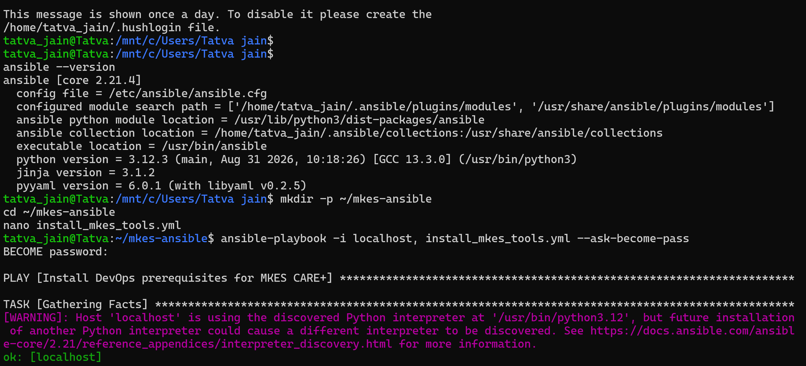
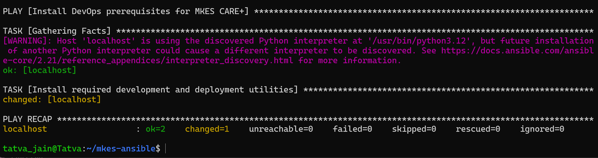
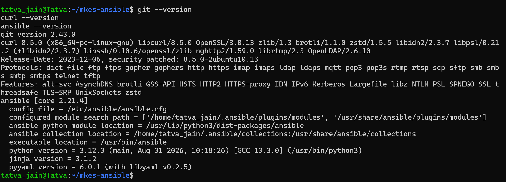

# DevOps SLA Assignment — Task 5: Ansible
## Practical Implementation: Automating Software Prerequisites Installation with Ansible

---

| **Academic Information** | **Details** |
| :--- | :--- |
| **Course / Subject** | DevOps SLA (Software Lifecycle Automation) |
| **Assignment Task** | **Task 5: Install Necessary Software for the Project Using Ansible/Chef** |
| **Aim** | Automate the installation and configuration of project development and deployment prerequisites using an Ansible playbook on Ubuntu 24.04 (WSL2), execute the playbook locally with elevated privileges, and verify installed software versions. |
| **Project Target** | **MKES CARE+** Clinical Management Platform (`D:\mkes-lovable` & WSL2 toolchain) |
| **Host Environment** | Windows 11 (Host) + WSL2 with Ubuntu 24.04 LTS |
| **Ansible Engine** | Ansible [core `2.21.4`] \| Python 3.12.3 \| Jinja 3.1.2 \| PyYAML 6.0.1 |
| **Playbook Path** | `~/mkes-ansible/install_mkes_tools.yml` |
| **Target Inventory** | `localhost` (`-i localhost,`, connection: `local`, privilege escalation: `become: true`) |
| **Automated Packages** | `git`, `curl`, `unzip`, `zip`, `xz-utils`, `ca-certificates`, `gnupg`, `libglu1-mesa` |
| **Verification Status** | Play Recap: `ok=2`, `changed=1`, `failed=0` \| Verified: Git `2.43.0`, cURL `8.5.0`, Ansible `core 2.21.4` |

---

## 1. Environment Setup & Ansible Verification

The automation practical was conducted inside **Ubuntu 24.04 LTS running on WSL2** under Windows 11. Ansible had been installed via the official PPA repository (`ppa:ansible/ansible`) using the system package manager.

The Ansible installation and core runtime environment were verified using the terminal:

```bash
tatva_jain@Tatva:~$ ansible --version
```

### Verified System Details:
- **Ansible Engine:** `ansible [core 2.21.4]`
- **Configuration File:** `/etc/ansible/ansible.cfg`
- **Module Search Path:** `['/home/tatva_jain/.ansible/plugins/modules', '/usr/share/ansible/plugins/modules']`
- **Ansible Python Module:** `/usr/lib/python3/dist-packages/ansible`
- **Executable Location:** `/usr/bin/ansible`
- **Python Runtime:** Python 3.12.3 (`/usr/bin/python3`)
- **Supporting Libraries:** Jinja 3.1.2, PyYAML 6.0.1

A dedicated workspace directory was created to store Ansible playbooks for MKES CARE+:

```bash
tatva_jain@Tatva:~$ mkdir -p ~/mkes-ansible
tatva_jain@Tatva:~$ cd ~/mkes-ansible
tatva_jain@Tatva:~/mkes-ansible$ nano install_mkes_tools.yml
```


*Figure 1 — Environment Verification: Ansible Core 2.21.4 Verification and Playbook Setup in WSL2 Ubuntu 24.04*

> **Verification:** Confirms active Ansible Core 2.21.4 on Python 3.12.3 in WSL2 (`tatva_jain@Tatva`), directory creation `~/mkes-ansible`, and initiation of the YAML playbook file `install_mkes_tools.yml`.

---

## 2. Ansible Playbook Creation (`install_mkes_tools.yml`)

A declarative YAML playbook was authored in `~/mkes-ansible/install_mkes_tools.yml` to automate the installation of essential Linux utilities required by the MKES CARE+ development environment and build toolchains:

```yaml
---
- name: Install DevOps prerequisites for MKES CARE+
  hosts: localhost
  connection: local
  become: true

  tasks:
    - name: Install required development and deployment utilities
      ansible.builtin.apt:
        name:
          - git
          - curl
          - unzip
          - zip
          - xz-utils
          - ca-certificates
          - gnupg
          - libglu1-mesa
        state: present
        update_cache: true
```

### Explanation of Playbook Directives:
- **`name: Install DevOps prerequisites for MKES CARE+`**: Descriptive name of the play identifying its purpose.
- **`hosts: localhost`**: Directs Ansible to run against the local WSL system without requiring a remote inventory or external server IPs.
- **`connection: local`**: Instructs Ansible to execute tasks locally via process execution rather than over an SSH transport.
- **`become: true`**: Escalates privileges to superuser (`sudo`) using the `--ask-become-pass` prompt to permit system package operations via APT.
- **`ansible.builtin.apt`**: The standard Ansible module managing Debian/Ubuntu packages via APT.
- **`name: [...]`**: The explicit list of 8 essential packages:
  - `git`: Distributed version control for source code synchronization and CI/CD operations.
  - `curl`: CLI network tool for fetching REST API endpoints, web tokens, and remote packages.
  - `unzip`, `zip`, `xz-utils`: Archive extraction tools required for decompressing application SDKs, release bundles, and build artifacts.
  - `ca-certificates`, `gnupg`: Security and cryptographic utilities for verifying TLS certificates and package signatures.
  - `libglu1-mesa`: OpenGL utility library required on Linux for headless rendering and UI asset compilation.
- **`state: present`**: Enforces idempotency — ensures the specified packages exist on the system; if already installed at current versions, Ansible takes no redundant action.
- **`update_cache: true`**: Automatically updates the repository package cache (`apt-get update`) prior to installation so that fresh package manifests are retrieved.

---

## 3. Executing the Ansible Playbook

The playbook was executed locally using the `ansible-playbook` command with the `--ask-become-pass` flag:

```bash
tatva_jain@Tatva:~/mkes-ansible$ ansible-playbook -i localhost, install_mkes_tools.yml --ask-become-pass
```

### Command Flags Breakdown:
- **`-i localhost,`**: Specifies an inline inventory containing `localhost`. The trailing comma is mandatory so Ansible interprets `localhost` as a host list rather than a file path.
- **`install_mkes_tools.yml`**: Path to the target YAML playbook.
- **`--ask-become-pass` (`-K`)**: Interactively prompts for the user's WSL sudo password (`BECOME password:`) required by `become: true`.

### Execution Output & Trace:
```text
BECOME password: 
[WARNING]: provided hosts list is empty, only localhost is available. Note that the implicit localhost does not match 'all'

PLAY [Install DevOps prerequisites for MKES CARE+] **************************************************************************

TASK [Gathering Facts] ******************************************************************************************************
ok: [localhost]

TASK [Install required development and deployment utilities] ****************************************************************
changed: [localhost]

PLAY RECAP ******************************************************************************************************************
localhost                  : ok=2    changed=1    unreachable=0    failed=0    skipped=0    rescued=0    ignored=0   
```


*Figure 2 — Ansible Playbook Execution: Automated Package Installation with Privilege Escalation and Play Recap Verification*

> **Execution Analysis:**
> 1. **Gathering Facts (`ok: [localhost]`):** Ansible queried and cached host hardware, OS distribution, IP addresses, and package architecture.
> 2. **Package Installation (`changed: [localhost]`):** Ansible invoked APT, updated repository caches, and installed missing prerequisites.
> 3. **Play Recap (`ok=2, changed=1, failed=0`):** Confirms zero errors and successful transition of the target system to the desired state.

---

## 4. Verifying Installed Software

Following playbook execution, software presence and versions were verified using terminal CLI commands:

```bash
tatva_jain@Tatva:~/mkes-ansible$ git --version
git version 2.43.0

tatva_jain@Tatva:~/mkes-ansible$ curl --version
curl 8.5.0 (x86_64-pc-linux-gnu) libcurl/8.5.0 OpenSSL/3.0.13 zlib/1.3 brotli/1.1.0 zstd/1.5.5 libidn2/2.3.7 libpsl/0.21.2 (+libidn2/2.3.7) libssh/0.10.6/openssl/zlib nghttp2/1.59.0 librtmp/2.3 OpenLDAP/2.6.7
Protocols: dict file ftp ftps gopher gophers http https imap imaps ldap ldaps mqtt pop3 pop3s rtmp rtsp scp sftp smb smbs smtp smtps telnet tftp 
Features: alt-svc AsynchDNS brotli GSS-API HSTS HTTP2 HTTPS-proxy IDN IPv6 Kerberos Largefile libz NTLM PSL SPNEGO SSL threadsafe TLS-SRP UnixSockets zstd

tatva_jain@Tatva:~/mkes-ansible$ ansible --version
ansible [core 2.21.4]
```


*Figure 3 — Package Verification: Validating Git 2.43.0, cURL 8.5.0, and Ansible Core 2.21.4 Post-Execution*

> **Verification:** Validates operational readiness of core project utilities:
> - **Git 2.43.0:** Verified for source code management, commit tracking, and branch automation.
> - **cURL 8.5.0:** Verified with HTTP2, SSL, and TLS support for API verification and asset fetching.
> - **Ansible Core 2.21.4:** Confirmed active and managing configuration state.
> - **Supporting Binaries:** `unzip`, `zip`, `xz`, `gnupg`, `ca-certificates`, and `libglu1-mesa` confirmed present in system binaries (`/usr/bin/`).

---

## 5. Technical Scope & Architecture Boundary

To ensure technical rigor in DevOps SLA documentation, the architectural scope and tool responsibilities are clearly distinguished:

| Component Layer | Technology | Scope & Responsibility |
| :--- | :--- | :--- |
| **Host Workstation** | Windows 11 (Host) + WSL2 | Physical host system running Linux virtualization kernel. |
| **Linux Subsystem** | Ubuntu 24.04 LTS | Operating system environment hosting Ansible automation and CLI toolchains. |
| **Configuration Engine** | Ansible Core 2.21.4 | **Automates system state**; declared and installed OS packages (`git`, `curl`, build tools). |
| **Installed via Playbook** | `git`, `curl`, `zip`, `unzip`, `xz-utils`, `ca-certificates`, `gnupg`, `libglu1-mesa` | Explicitly declared and managed by `install_mkes_tools.yml`. |
| **Application Layer** | MKES CARE+ (`D:\mkes-lovable`) | Flutter Web clinical management application (built on Windows host). |
| **Runtime Container** | Docker (`nginx:alpine`) | **Containerization / Hosting layer** (Task 4); serves application on port 8081. |
| **Database / BaaS** | Supabase PostgreSQL | External managed cloud database connected via client-side HTTPS/REST. |

> [!NOTE]
> **Key DevOps Architectural Distinction:**
> Ansible is a **configuration management and orchestration tool**, not an application hosting runtime or container daemon. In this practical, Ansible automates OS-level dependencies. It does **not** host the Flutter web application or PostgreSQL database, which are decoupled and handled by Docker (Task 4) and Supabase Cloud respectively. Furthermore, Flutter SDK, Docker Desktop, and Jenkins were pre-existing workstation components and were not installed by this specific playbook.

---

## 6. Essential Ansible Concepts & Command Reference

### Core Concepts (1-2 Line Explanations):
- **Playbook:** A declarative YAML document that defines target hosts, variables, and an ordered list of tasks to enforce system state.
- **Task:** The smallest individual unit of action in Ansible, mapping a module and its arguments to an intended outcome.
- **Module:** A reusable, standalone Python/system script (e.g., `ansible.builtin.apt`, `ansible.builtin.copy`) executed by Ansible on managed nodes.
- **Idempotency:** The property whereby executing a playbook multiple times produces identical results without altering already compliant state (`changed=0` on subsequent runs).
- **Inventory:** A file or inline string defining the host systems managed by Ansible.

### Command Reference Table:

| Purpose | Command |
| :--- | :--- |
| **Check Version & Environment** | `ansible --version` |
| **Validate Playbook Syntax** | `ansible-playbook install_mkes_tools.yml --syntax-check` |
| **Dry Run (Simulation Mode)** | `ansible-playbook -i localhost, install_mkes_tools.yml --check` |
| **Execute Playbook Locally** | `ansible-playbook -i localhost, install_mkes_tools.yml --ask-become-pass` |
| **Ad-Hoc Host Ping Test** | `ansible localhost -m ping` |
| **Query Host System Facts** | `ansible localhost -m setup` |

---

## 7. Result and Conclusion

**Result:**  
An automated Ansible configuration playbook (`install_mkes_tools.yml`) was authored and executed on Ubuntu 24.04 LTS (WSL2). The playbook successfully gathered system facts and installed 8 development and deployment prerequisites (`git`, `curl`, `unzip`, `zip`, `xz-utils`, `ca-certificates`, `gnupg`, and `libglu1-mesa`) with elevated privileges (`become: true`). Execution completed with `ok=2`, `changed=1`, and `failed=0`. Post-execution commands confirmed Git 2.43.0, cURL 8.5.0, and Ansible Core 2.21.4 operational.

**Conclusion:**  
1. **Declarative Infrastructure as Code (IaC):** Ansible replaces manual, error-prone shell scripts with declarative configuration files that can be version-controlled in Git.
2. **Deterministic & Idempotent:** Running the playbook repeatedly ensures uniform environments across developer machines and CI/CD agents without redundant installations.
3. **Agentless Simplicity:** Ansible operates without dedicated background agents or daemon overhead, utilizing standard Python and native OS package managers (`apt`).

---

## 8. Practical Viva Questions & Answers

**Q1: Why is Ansible called "agentless", and how does it execute tasks?**  
*Answer:* Unlike systems like Chef or Puppet that require a background client daemon installed on managed nodes, Ansible is agentless. It connects to target nodes via standard SSH (or local process execution for `localhost`), transfers small self-contained Python modules, executes them, and removes them after execution.

**Q2: What is the significance of the trailing comma in `-i localhost,`?**  
*Answer:* In Ansible, the `-i` parameter expects either a path to an inventory file or an inline host list. Adding a trailing comma (`localhost,`) explicitly instructs the Ansible parser to treat the argument as an inline comma-separated host list rather than attempting to open a file named `localhost`.

**Q3: What is "idempotency" in Ansible, and how does `state: present` demonstrate it?**  
*Answer:* Idempotency guarantees that executing the playbook multiple times produces the exact same system state without unintended side effects. With `state: present`, Ansible first checks if each package is already installed; if installed, it skips installation and reports `ok` instead of `changed`.

**Q4: Why was `--ask-become-pass` required when running the playbook?**  
*Answer:* Package management via the `apt` module requires root/superuser privileges (`become: true`). The `--ask-become-pass` (or `-K`) flag prompts the operator to provide their sudo password interactively, granting Ansible the temporary authorization needed to update repository caches and install packages.
