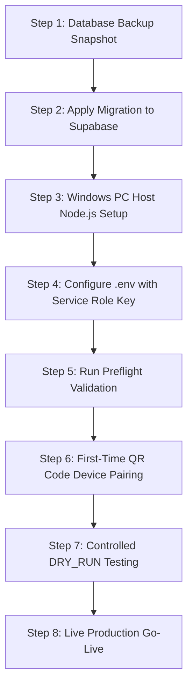

# MKES CARE+ — Production Deployment & Operations Guide
## WhatsApp Automation & Conversational Appointment Booking

**Authoritative Target**: MKES CARE+ Hospital, Malad West, Mumbai  
**Clinical Scope**: Eye Clinic (Ophthalmology) & Dental Care (*Optical strictly excluded*)  
**Architecture**: Cloud Supabase Database (PostgreSQL 15+) + Clinic Windows PC Host (Node.js 18+ Daemon with `whatsapp-web.js`) + Flutter Cross-Platform Client

---

## 1. Architecture & Technology Confirmation

### Confirmed WhatsApp Library
- **Library**: `whatsapp-web.js` (version `^1.26.0`) with Chromium/Puppeteer and `LocalAuth`.
- **Clarification**: Early development notes occasionally mentioned alternative headless protocols (such as Baileys). The actual codebase, dependency definitions, and source files (`package.json`, `src/services/whatsapp_client.js`) have always utilized **`whatsapp-web.js`**. There is no dependency on Baileys, and no library switch is needed or recommended.
- **Session Strategy**: Puppeteer operates in headless mode with persistent session storage managed by `LocalAuth` located at `C:\MKES_CARE_PLUS\wa_session`.

---

## 2. Pre-Deployment Verification Summary (Local)

The entire backend and client implementation has been verified in local isolated environments:
- **Compiled PostgreSQL WASM / Native 17.7**: Full database test suites passed (migration execution, table constraints, direct update trigger guard, dynamic slot generator, dual advisory lock approval RPC, outbox batch claims, opt-out cancellation, scheduled batch enqueuers, and chat session JSONB persistence).
- **Node.js Integration Suite**: 120/120 unit tests passed across 19 test suites (phone normalization, collision math, crash recovery, status guard, doctor eligibility, opt-out races, slot inputs, privilege matrix, DRY_RUN lifecycle, IST date choice 1/2/3, debouncing, optical exclusion, duplicate request prevention, end-to-end booking simulation, dashboard approval, automated messaging triggers, and festival broadcasts).
- **Flutter Codebase**: `flutter analyze` reports **0 issues found** across all models, providers, and dashboard screens.
- **Node.js Syntax & Diagnostics**: 16/16 preflight checks passed (`npm run validate`).


---

## 3. Production Deployment Checklist (Step-by-Step)

> [!IMPORTANT]
> **Safety Notice:** Do NOT perform these steps until you receive separate, explicit user approval to touch the live Supabase database or pair the clinic WhatsApp account.



### Step 1: Database Backup Snapshot
1. Log in to the [Supabase Dashboard](https://supabase.com/dashboard/project/mfalgfodhsszyxnfiofi).
2. Navigate to **Database** → **Backups**.
3. Create a manual point-in-time backup or export a schema/data dump:
   ```bash
   supabase db dump -f mkes_care_plus_pre_whatsapp_backup.sql
   ```

### Step 2: Apply Database Migration
1. Review the migration file:
   [`supabase/migrations/20261019000000_whatsapp_automation_foundation.sql`](file:///c:/MKES%20PRO/mkes-care-plus-lovable/supabase/migrations/20261019000000_whatsapp_automation_foundation.sql)
2. Apply the migration using Supabase CLI:
   ```bash
   supabase db push
   ```
   *Or* copy the contents into the Supabase Dashboard **SQL Editor** and run.
3. Confirm tables created:
   - `public.whatsapp_settings`
   - `public.whatsapp_templates`
   - `public.whatsapp_messages_outbox`
   - `public.whatsapp_message_logs`
   - `public.whatsapp_chat_sessions`
   - `public.whatsapp_appointment_requests`
4. Confirm columns added:
   - `public.appointments.duration_minutes` (default 15)
   - `public.appointments.ai_booked` (default false)
   - `public.patients.whatsapp_opt_out` (default false)

### Step 3: Clinic Windows PC Setup
1. Host requirements:
   - Windows 10/11 Pro or Windows Server on clinic reception PC.
   - Node.js LTS (v18.x or v20.x) installed from [nodejs.org](https://nodejs.org).
   - Google Chrome installed (for Puppeteer browser engine).
   - PM2 process manager installed globally:
     ```cmd
     npm install -g pm2
     ```
2. Create persistent session folder:
   ```cmd
   mkdir C:\MKES_CARE_PLUS\wa_session
   ```
3. Secure folder permissions:
   - Restrict read/write permissions to the Administrator and the local Windows user account running the clinic reception desktop.

### Step 4: Configure Production Secrets (`.env`)
1. In `whatsapp-service/`:
   ```cmd
   copy .env.example .env
   ```
2. Edit `.env` with actual production secrets:
   ```ini
   SUPABASE_URL=https://mfalgfodhsszyxnfiofi.supabase.co
   SUPABASE_SERVICE_ROLE_KEY=<production_service_role_secret>
   WA_SESSION_PATH=C:\MKES_CARE_PLUS\wa_session
   MIN_SEND_DELAY_MS=6000
   MAX_SEND_DELAY_MS=14000
   TYPING_SIMULATION_MS=2500
   DAILY_SEND_LIMIT=200
   OUTBOX_POLL_INTERVAL_MS=5000
   SCHEDULER_MODE=host
   DRY_RUN=true
   TEST_PHONE_WHITELIST=9876543210
   LOG_LEVEL=info
   ```
   > [!WARNING]
   > Ensure `.env` is listed in `.gitignore` and NEVER committed to GitHub or embedded in Flutter client builds.

### Step 5: Install Dependencies & Run Preflight Validation
1. Install Node.js dependencies:
   ```cmd
   npm install
   ```
2. Execute the preflight diagnostic:
   ```cmd
   npm run validate
   ```
3. Confirm output: **16 / 16 checks passed (READY for Windows background service deployment)**.

### Step 6: Initial WhatsApp Device Pairing (Process Safety Guard)
> [!WARNING]
> **Process Collision Prevention:** Never run interactive pairing (`npm start`) while PM2 is actively running `mkes-wa-bridge`. Both processes will attempt to open Chromium in `C:\MKES_CARE_PLUS\wa_session`, causing session corruption or locking errors.

1. Ensure PM2 is stopped before pairing:
   ```cmd
   pm2 stop mkes-wa-bridge
   ```
2. Check that no background Node or Chrome process is holding session locks:
   ```cmd
   tasklist | findstr /i "node.exe chrome.exe"
   ```
3. Start the service interactively to display the pairing QR code in the console:
   ```cmd
   cd whatsapp-service
   npm start
   ```
4. A QR code will display directly in your terminal window:
   ```
   [INFO] WhatsApp QR Code generated. Scan with clinic smartphone to pair:
   ```
5. On the clinic reception smartphone:
   - Open WhatsApp.
   - Tap **Linked Devices** → **Link a Device**.
   - Point the camera at the terminal QR code.
6. When connected, the terminal logs:
   ```
   [INFO] WhatsApp Web client is READY and connected!
   ```
7. Press `Ctrl + C` in the terminal to stop the interactive session cleanly and release Puppeteer file locks. All session tokens are now securely stored in `C:\MKES_CARE_PLUS\wa_session`.

### Step 7: Controlled Staging Test (`DRY_RUN=true`)
> [!IMPORTANT]
> **Understanding the 3 Tiers of Message Flow in Staging:**
> 1. **Inbound Processing**: Inbound WhatsApp messages are received via WebSocket, parsed by `BotEngine`, and advance conversation sessions in `whatsapp_chat_sessions`.
> 2. **Simulated Outbound Messages**: Outbound responses are formulated and logged with `[DRY RUN INTERCEPTED]`, but **physical transmission over WhatsApp Web is blocked**. The test phone **will not receive a WhatsApp text reply**. Outbox records in Supabase remain in `pending` status. Actual delivery must NEVER be claimed during dry-run testing.
> 3. **Approved Real Outbound Delivery**: Occurs strictly when `DRY_RUN=false` is explicitly set, allowing the WhatsApp client to transmit real payloads to recipient phones.

1. Keep safe simulation defaults in `whatsapp-service/.env`:
   ```ini
   DRY_RUN=true
   TEST_PHONE_WHITELIST=9876543210
   ```
2. Start the service under PM2:
   ```cmd
   pm2 start index.js --name mkes-wa-bridge --max-memory-restart 1200M --restart-delay 3000 --exp-backoff-restart-delay 100
   pm2 save
   ```
3. Verify process status and ensure only one PM2 instance is running:
   ```cmd
   pm2 status
   ```
   Confirm `mkes-wa-bridge` shows status `online` with a single process ID.
4. Send an inbound test message from the whitelisted smartphone:
   - Send: `Hi`
   - Send: `1` (for Today) or `2` (for Tomorrow)
   - Send: `1` (for slot choice)
5. Verify simulated handling in PM2 logs (no physical message will be delivered to the phone):
   ```cmd
   pm2 logs mkes-wa-bridge --lines 50
   ```
   Confirm log entries:
   - `[INFO] Received inbound message from 919876543210@c.us: "Hi"`
   - `[INFO] [DRY RUN INTERCEPTED] Real dispatch blocked by default safe mode. Simulated send to 919876543210@c.us...`
6. Open the MKES CARE+ Flutter Staff Portal:
   - Check the **WhatsApp Requests** badge in the Schedule screen.
   - Confirm the request appears in `pending_review` status.
   - Click **Approve & Book**, assign doctor, and confirm.
   - Verify appointment appears immediately in the clinical schedule (`ai_booked = true`).

### Step 8: Production Go-Live (`DRY_RUN=false`)
> [!CAUTION]
> **Live Messaging Activation:** Only perform this step after explicit clinical administrator approval. Real messages will be transmitted across the WhatsApp telecom network.

1. Edit `whatsapp-service/.env`:
   - Set `DRY_RUN=false`
   - Comment out or clear `TEST_PHONE_WHITELIST`
2. Restart the PM2 service to apply live settings:
   ```cmd
   pm2 restart mkes-wa-bridge
   ```
3. Register PM2 Windows background service for auto-start on boot:
   ```cmd
   npm run install-service
   ```
   *Or run `scripts\install_windows_service.bat` as Administrator.*
4. Monitor live dispatches and heartbeat logs:
   ```cmd
   pm2 logs mkes-wa-bridge
   ```


---

## 4. Operator Troubleshooting & Routine Operations

| Symptom | Probable Cause | Action Required |
| :--- | :--- | :--- |
| Terminal shows `[ERROR] Protocol error: Target closed` | Chrome/Puppeteer process crashed | Restart service: `pm2 restart mkes-wa-bridge`. |
| Disconnected from WhatsApp (`session_status: disconnected`) | Clinic phone logged out from WhatsApp Mobile | Delete session folder `C:\MKES_CARE_PLUS\wa_session`, run `npm start` interactively, and re-scan the QR code. |
| Inbound messages not triggering replies | Patient is opted out (`whatsapp_opt_out = true`) | Check `whatsapp_settings.is_enabled` and verify patient row in database. |
| Appointment slots not showing | Clinic hours closed, or all doctors occupied | Verify `operating_hours_start` and `operating_hours_end` in `whatsapp_settings`. |
| Duplicate reminder prevention | 20-hour deduplication window active | Normal behavior; the system intentionally prevents sending more than one 24h reminder to the same patient. |

---

## 5. Non-Destructive Staged Rollback Procedure

If the migration ever needs to be rolled back, execute this **6-stage plan**:

```sql
-- Stage 1: Unschedule pg_cron jobs (if active)
DO $$ DECLARE r RECORD; BEGIN
  IF EXISTS (SELECT 1 FROM pg_extension WHERE extname = 'pg_cron') THEN
    FOR r IN SELECT jobname FROM cron.job WHERE jobname LIKE 'mkes-wa-%' LOOP
      PERFORM cron.unschedule(r.jobname);
    END LOOP;
  END IF;
END $$;

-- Stage 2: Archive Audit Trails (Safe Idempotent Anti-Join)
CREATE TABLE IF NOT EXISTS public._archive_whatsapp_message_logs (
  LIKE public.whatsapp_message_logs INCLUDING DEFAULTS INCLUDING CONSTRAINTS INCLUDING INDEXES
);
INSERT INTO public._archive_whatsapp_message_logs
SELECT src.* FROM public.whatsapp_message_logs src
WHERE NOT EXISTS (
  SELECT 1 FROM public._archive_whatsapp_message_logs arc WHERE arc.id = src.id
);

CREATE TABLE IF NOT EXISTS public._archive_whatsapp_messages_outbox (
  LIKE public.whatsapp_messages_outbox INCLUDING DEFAULTS INCLUDING CONSTRAINTS INCLUDING INDEXES
);
INSERT INTO public._archive_whatsapp_messages_outbox
SELECT src.* FROM public.whatsapp_messages_outbox src
WHERE NOT EXISTS (
  SELECT 1 FROM public._archive_whatsapp_messages_outbox arc WHERE arc.id = src.id
);

CREATE TABLE IF NOT EXISTS public._archive_whatsapp_appointment_requests (
  LIKE public.whatsapp_appointment_requests INCLUDING DEFAULTS INCLUDING CONSTRAINTS INCLUDING INDEXES
);
INSERT INTO public._archive_whatsapp_appointment_requests
SELECT src.* FROM public.whatsapp_appointment_requests src
WHERE NOT EXISTS (
  SELECT 1 FROM public._archive_whatsapp_appointment_requests arc WHERE arc.id = src.id
);

-- Stage 3: Drop Triggers on Core Tables
DROP TRIGGER IF EXISTS trg_dental_lab_ready_wa ON public.dental_lab;
DROP TRIGGER IF EXISTS trg_billing_payment_wa ON public.billing_payments;
DROP TRIGGER IF EXISTS trg_vendor_po_wa ON public.purchase_orders;
DROP TRIGGER IF EXISTS trg_guard_appointment_request_status ON public.whatsapp_appointment_requests;

-- Stage 4: Drop Functions (Reverse Dependency Order)
DROP FUNCTION IF EXISTS public.trg_fn_dental_lab_ready_wa();
DROP FUNCTION IF EXISTS public.trg_fn_billing_payment_wa();
DROP FUNCTION IF EXISTS public.trg_fn_vendor_po_wa();
DROP FUNCTION IF EXISTS public.trg_fn_guard_appointment_request_status();
DROP FUNCTION IF EXISTS public.approve_whatsapp_appointment_request(UUID, UUID, TEXT);
DROP FUNCTION IF EXISTS public.reject_whatsapp_appointment_request(UUID, TEXT);
DROP FUNCTION IF EXISTS public.get_available_appointment_slots(TEXT, DATE, INT, INT, UUID);
DROP FUNCTION IF EXISTS public.claim_whatsapp_outbox_batch(UUID, INT, INT);
DROP FUNCTION IF EXISTS public.register_patient_whatsapp_opt_out(TEXT);
DROP FUNCTION IF EXISTS public.set_patient_whatsapp_opt_out(UUID, BOOLEAN);
DROP FUNCTION IF EXISTS public.enqueue_appointment_reminders_batch();
DROP FUNCTION IF EXISTS public.enqueue_annual_eye_reminders_batch();
DROP FUNCTION IF EXISTS public.enqueue_dental_followups_batch();
DROP FUNCTION IF EXISTS public.enqueue_birthday_greetings_batch();
DROP FUNCTION IF EXISTS public.enqueue_google_review_requests_batch();
DROP FUNCTION IF EXISTS public.enqueue_billing_payment_reminders_batch();
DROP FUNCTION IF EXISTS public.enqueue_festival_greeting_broadcast(TEXT, TEXT);

-- Stage 5: Drop WhatsApp Tables in Dependency Order (Child to Parent, NO CASCADE)
DROP TABLE IF EXISTS public.whatsapp_message_logs;
DROP TABLE IF EXISTS public.whatsapp_messages_outbox;
DROP TABLE IF EXISTS public.whatsapp_appointment_requests;
DROP TABLE IF EXISTS public.whatsapp_chat_sessions;
DROP TABLE IF EXISTS public.whatsapp_templates;
DROP TABLE IF EXISTS public.whatsapp_settings;

-- Stage 6: Reload PostgREST Cache
NOTIFY pgrst, 'reload schema';

-- PRESERVED IN CORE PERMANENTLY:
-- 1. public.appointments (clinical bookings are never deleted)
-- 2. public.appointments.duration_minutes
-- 3. public.appointments.ai_booked
-- 4. public.patients.whatsapp_opt_out (DPDP consent compliance)
-- 5. public.patients.dob
-- 6. public.dental_treatments.procedure_status
-- 7. public._archive_whatsapp_* (audit evidence)
```

---

## 6. Handover Runbook: Irreversible Actions, Rollback Limitations & Live Boundary

### A. Irreversible Actions & Rollback Limitations
1. **Dispatched WhatsApp Messages Cannot Be Recalled**:
   - Once a message is transmitted over WhatsApp Web (`status = 'sent'`), it exists on WhatsApp's telecommunication infrastructure and on the recipient's phone. A database rollback removes local audit rows but cannot unsend delivered WhatsApp messages.
2. **Clinical Appointment Records Are Permanent**:
   - When a WhatsApp appointment request is approved, it promotes to `public.appointments` (`ai_booked = true`). Rollback scripts deliberately **preserve** all promoted rows in `public.appointments` to prevent accidental clinical data loss or disruption to scheduled patient care.
3. **DPDP Act Opt-Out Consent Must Never Be Cleared**:
   - Patient opt-out preferences (`patients.whatsapp_opt_out = true`) must remain permanently intact, even if the WhatsApp automation tables are dropped. Reverting opt-out flags would cause non-consensual messaging upon service re-enablement, violating Indian digital data privacy regulations.
4. **Dropped Table Data Recovery**:
   - Dropping `whatsapp_messages_outbox` or `whatsapp_chat_sessions` permanently destroys in-flight conversation state unless the `_archive_whatsapp_*` staging tables created in Stage 2 of the rollback script are safely backed up before table drops.

### B. Live Integration Dependency Matrix & Approval Boundary

| Action Step | Location / Host | Prerequisites | Risk Level | Approval Required? |
| :--- | :--- | :--- | :--- | :--- |
| **1. Apply SQL Migration** | Cloud Supabase (`mfalgfodhsszyxnfiofi`) | Pre-migration backup verified (`861,733 bytes`) | Medium (Schema extension) | **YES — User Approval Required** |
| **2. Provision Production Key** | Clinic PC (`whatsapp-service/.env`) | Elevated Service Role Secret from Supabase Dashboard | Sensitive (Secret storage) | **YES — Administrator Placement** |
| **3. Install Windows Service** | Clinic Reception Windows PC | Node.js LTS, Chrome, Administrator cmd | Low (Local host registration) | No (Routine host script) |
| **4. Interactive QR Scan** | Clinic Reception Desktop + Smartphone | Clinic WhatsApp business number on phone | Low (Local credential caching) | **YES — Staff Physical Action** |
| **5. Controlled Staging Test** | Clinic Host PC (`DRY_RUN=true`) | `TEST_PHONE_WHITELIST=<admin_mobile>` | Zero (No live dispatch) | No (Safe dry-run) |
| **6. Production Go-Live** | Clinic Host PC (`DRY_RUN=false`) | Staging verified; whitelists removed | Live (Active messaging) | **YES — Final Sign-off** |

